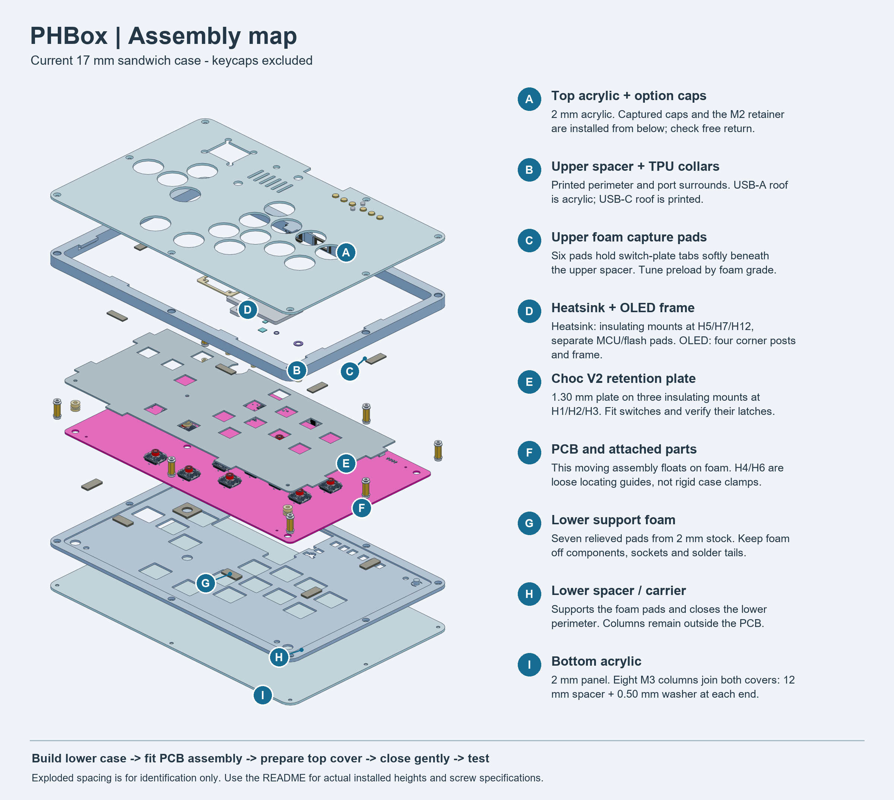
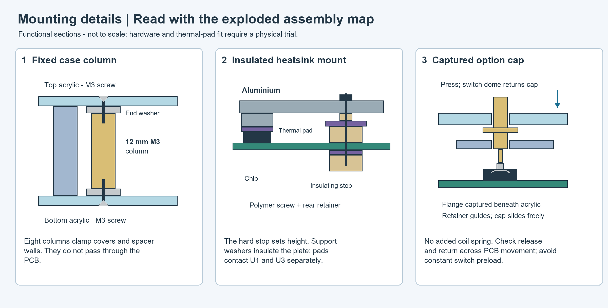

# PHBox

RP2350A arcade controller: 13/16-button layout, Kailh Choc V2 switches, per-key RGB, SH1106 OLED, USB-C input and top-side USB-A host port. Uses configurable GP2040-CE pin assignments; hardware compatibility remains a prototype test.

**30 October ergonomic revision:** [higher/wider PCB and matching case candidate](mechanical/ergonomic_layout_2026-10-30/README.md), with 32 mm action-column spacing, 20 mm Choc V2-compatible SGF MonKeys/generic round caps and more palm space. The cap selection and cover-opening inputs are updated; current export status is recorded in the candidate README. Electrical routing remains unfinished. The root PCB and earlier mock-print packages retain the preceding layout.

The **[replacement-only A1 print job](mechanical/ergonomic_layout_2026-10-30/REPRINT_A1/README.md)** regenerates the changed mock parts plus three PLA blanking plugs as one supported vertical stack. It uses PLA models and PETG release interfaces; unchanged pieces of the earlier kit are reused.

## Active design and manufacture

- Active KiCad 10 sources: [project](Flatbox-rev8.kicad_pro), [schematic](Flatbox-rev8.kicad_sch), [PCB](Flatbox-rev8.kicad_pcb), plus local libraries and `3dmodels`.
- **USB2 moved to the top on 8 October:** [revision and checks](mechanical/USB2-top-assessment-2026-10-08.md). Existing manufacturing files below are the preceding bottom-side revision; regenerate Gerbers/CPL and visually approve USB2 orientation before ordering the current PCB.
- [Manufacturing package](manufacturing/PHBox_2026-10-06_DFM_resolved/README.md), [complete ZIP](manufacturing/PHBox_2026-10-06_DFM_resolved.zip), [mandatory notes](manufacturing/PHBox_2026-10-06_DFM_resolved/MANUFACTURING-NOTES.md) and [DFM evidence](manufacturing/PHBox_2026-10-06_DFM_resolved/validation/rerun-summary.md).
- C41 / C29936 is included in BOM/CPL. Refresh the separate BOM matching site and visually approve placements, especially USB2, before assembly release.
- **USB2 replaced on 9 October:** [C2344 through-hole revision and checks](mechanical/USB2-C2344-assessment-2026-10-09.md). Uses Jing 902-131A1021D10100, with a drawing-derived STEP seated at the PCB datum. Existing manufacturing exports and quote still need regeneration; request mixed-assembly solder-process review for this through-hole part.

## Ordering guide

Current quote selections read on 8 October 2026; no order submitted. These are selected form values, not factory acceptance.

| Option | Selected value |
|---|---|
| Base material / material grade | FR-4 / FR4 TG135 |
| Layers / product type | 4 / Industrial/Consumer electronics |
| Designs / delivery | 1 / Single PCB |
| PCB quantity | 5 |
| Thickness | 1.6 mm |
| Mask / silkscreen | Black / White |
| Surface finish | HASL (with lead) |
| Outer / inner copper | 1 oz / 0.5 oz |
| Specify layer sequence / stackup | Yes / Yes |
| Stackup | JLC04161H-7628 |
| Impedance control | No requirement |
| Via covering | Epoxy Filled & Capped (selected; control currently disabled) |
| Via plating | Horizontal Electroless Copper Plating |
| Minimum via hole/land | 0.3 mm / 0.4–0.45 mm |
| Outline tolerance | ±0.2 mm (Regular) |
| Confirm production files | Yes; automatic approval disabled in earlier verified dialog |
| Mark / electrical test | Remove Mark / Flying Probe Fully Test |
| Gold fingers / castellated holes | No / No |
| Press-fit holes / edge plating | No / No |
| Blind slots / backdrill | No / No |
| UL marking / humidity indicator card | No / No |
| PCBA type / assembly side | Standard / Both Sides |
| PCBA quantity | 5 |
| Edge rails/fiducials | Added by JLCPCB; two 5 mm rails |
| Confirm parts placement | Yes |
| Stencil storage / fixture storage | No / No |
| Parts selection | By Customer (Self-Service) |
| Separate stencil order | Not enabled; no separate stencil thickness selected |

The quote displays **272.6 × 181 mm including assembly rails**; finished board artwork is **272.65 × 171.05 mm**. Follow the Gerber outline and verify dimensions in production artwork; do not resize the PCB to the rail-inclusive size. A depaneling service is suggested by the page but its selection is not verified.

Upload the [Gerber-only ZIP](manufacturing/PHBox_2026-10-06_DFM_resolved/upload/PHBox-DFM-resolved-Gerbers.zip), then [BOM](manufacturing/PHBox_2026-10-06_DFM_resolved/assembly/BOM-JLCPCB.csv) and [CPL](manufacturing/PHBox_2026-10-06_DFM_resolved/assembly/CPL-JLCDFM.csv) separately. Refresh the separate BOM matching site and visual preview, including C41 and USB2.

### Additional requirements and remarks

The **PCB remark is currently empty** in the live form, despite earlier entry; re-enter before submission. The current page does not expose a PCBA remark field. The short text below is prepared for that field, not already entered.

- Obtain explicit CAM confirmation that all nine **U1 0.35 mm ComponentDrill thermal holes** receive epoxy filling and copper capping. Ordinary via selection alone is insufficient. Preserve other component holes and use the supplied U1 hole map.
- Preserve U4's six **0.664 × 0.190 mm** paste apertures; obtain complete-board approval of a **0.10 mm stencil**. These are additional instructions, not selected quote options. Confirm X-ray inspection of U1's hidden exposed-pad joint.
- Confirm hand/THT assembly, OLED support and socket procurement. Retain manufacturer-land-pattern dispositions for D21/U1/U4/F1; verify polarity and accepted CPL rotations.
- **Leaded HASL differs from the source's Lead-Free setting.** Resolve finish before submission. Impedance control is not selected; USB impedance remains an engineering check against the chosen stackup.

Short additional-order remark (181 characters):

> U1: fill/cap 9 thermal ComponentDrill holes; X-ray EP joint. U4: keep 6 paste apertures 0.664x0.190mm; review 0.10mm stencil. Confirm manual parts, polarity and CPL before assembly.

The complete [manufacturing notes](manufacturing/PHBox_2026-10-06_DFM_resolved/MANUFACTURING-NOTES.md) and [ordering review](manufacturing/ordering-review-2026-10-08.md) retain dimensions, hole locations and acceptance requirements that cannot fit into one 200-character field.

## Final assembly by the user

Use the [sectioned final-assembly BOM and Perth-first supplier list](mechanical/assembly_bom_2026-10-31/README.md)
for quantities, purchasing status and exact-size requirements. It covers one unit
with 16 Choc V2 switches, 13 fitted 20 mm caps and three PLA blanking plugs.
Custom PETG keycaps are an authorized fallback if exact purchased caps cannot be
obtained with practical delivery; no new keycap model is included in the BOM.

Use the [current wider-layout part files](mechanical/ergonomic_layout_2026-10-30/README.md)
with the [17 mm sandwich assembly sequence](mechanical/sandwich_17mm_2026-10-08/README.md).
The wider PCB still requires routing and fresh manufacturing exports. Its combined
assembly STEP contains the earlier top cover; use the individual current parts.
This is a **prototype assembly guide**: nominal CAD fits have passed, but real
switches, hardware, foam and thermal pads must be trial-fitted before making the
finished enclosure. Overall case size is **292.6 × 191 × 17 mm**, excluding keycaps.

### How the parts are mounted

The layer order is **top acrylic → upper spacer and internal parts → PCB → foam
→ lower spacer/carrier → bottom acrylic**. The upper and lower spacer walls close
the perimeter; their heights are already included in the 17 mm total.

| Assembly | Mounting solution |
|---|---|
| Acrylic covers and spacer walls | Eight rigid columns outside the PCB: 12 mm M3 female/female spacers, with a 0.50 mm washer at each end. Screws enter from both covers. |
| PCB | Seven relieved foam pads beneath it; six upper foam pads capture the switch-plate tabs. Loose guides at H4/H6 locate it laterally. No case screws clamp through the PCB. |
| Choc V2 switch plate | Three custom insulating post/retainer pairs at H1/H2/H3, with polymer M3 screws. The 1.30 mm plate sits 3 mm above the PCB seating plane. |
| MCU/flash heatsink | Insulating hard stops, support washers and rear retainers at H5/H7/H12. Separate thermal pads contact U1 and U3. This attaches to the PCB, not the case. |
| OLED | Four custom insulating posts and rear caps, plus a corner frame and polymer M2 screws. The frame retains the module PCB without pressing its glass. |
| Option-button caps | Six captured plungers guided by the acrylic and a lower retainer. Two M2 screws secure the retainer to the cover; switch contact domes provide click and return. |
| USB ports | Integral spacer surrounds and compliant collars. Acrylic roofs USB-A; the spacer roofs USB-C. The collars close shell gaps while allowing PCB movement. |

The PCB, switch plate, heatsink and screen move together as one foam-supported
assembly. The CAD budgets ±0.50 mm XY and ±0.25 mm Z movement. Do not turn the
port collars, button guides or mounting screws into rigid links between it and
the outer case.

### Parts to prepare

| Part | Quantity / specification |
|---|---|
| Acrylic covers / printed spacer frames | One top and one bottom of each; acrylic is 2 mm thick |
| Case columns / end washers | 8 × M3 female/female, 12 mm, AF5; 16 × Ø7 / Ø3.4 / 0.50 mm washers |
| Case screws | 16 × M3×6, 90° countersunk |
| Switch-plate mounts / screws | 3 custom insulating post/cap pairs; 3 × M3×8 polymer, head no larger than Ø6 × 2.4 mm |
| OLED mounts / screws | 4 custom insulating post/cap pairs; 4 × M2×8 polymer, head no larger than Ø4 × 1.6 mm |
| Heatsink mounting set | 3 insulating hard stops, 3 support washers, 3 relieved rear washers and 3 tapped rear retainers; polymer M3 at H5/H7 and M2 at H12. Select screw lengths after measuring the assembled stack. |
| Thermal pads | Two electrically insulating pads: MCU 5.5 × 5.5 mm; flash 3.5 × 3.5 mm. Starting assumption: 0.50 mm free / 0.40 mm installed thickness. |
| Support foam | 7 lower pads from 2 mm stock; 6 upper pads from 1.5 mm stock, using the supplied cut profiles |
| Port collars | 2 printed unfilled, nonconductive TPU 95A trial collars, 2 mm deep; separate front-face-down STLs include the rear PCB rebates |
| Option caps / retainer / fasteners | 6 caps, 1 retainer, 2 × M2×5 pan-head screws (head ≤ Ø4 × 1.6 mm), 2 × M2 nuts (AF4 × 1.6 mm) |

Custom insulating mounts and retainers are supplied CAD parts, not ordinary
catalog standoffs. The heatsink uses flat insulating support washers in the
current model; an O-ring is an alternative only after checking its compressed
height and force. Keep the hard stops with either choice. Exact foam and thermal-pad
grades, heatsink screw lengths and the option-switch MPN remain to be qualified.

### TPU USB collars

Print one each of [USB-A](mechanical/sandwich_17mm_2026-10-08/STL/usb_a_collar.stl) and
[USB-C](mechanical/sandwich_17mm_2026-10-08/STL/usb_c_collar.stl). Both files are oriented
front mating face down on Z=0, with the rear PCB relief upward. Use unfilled,
nonconductive TPU 95A as the economical first trial. The PCB supports remain cut
foam and the other mounts keep their existing materials.

Start with 0.10 mm layers, dried filament and the filament maker's temperature
profile. Inspect the sliced rear relief: it leaves a **0.317 mm front membrane**.
Check that it prints continuously without tears; do not thicken it into the PCB
clearance. The supplied orientation avoids a roof over the rear relief. Trial
both collars before printing the full case, checking insertion, unplugging,
retention and freedom of the foam-mounted PCB. The intentional interference is
0.20 mm at the outer surround and 0.10 mm at the nominal connector shell.

Saved geometry clears the PCB travel envelope; TPU stiffness, creep and retention
have not been physically qualified. The collars close gaps but have no ingress
rating. Ordinary TPU does not replace the electrically insulating thermal pads.
[Prusa flexible-filament guidance](https://help.prusa3d.com/article/flexible-materials_2057)
explains printing and drying considerations.

### Buying materials: cost and delivery priority

For an unpowered fit trial, use the [printed mock-kit guide](mechanical/sandwich_17mm_2026-10-08/MOCK_ONLY/README.md): individual STLs include acrylic surrogates, case columns, mounting parts, collars and simplified PCB/display envelopes. Large parts have quarter-panel alternatives. Plastic heatsink and rigid pad gauges are for geometry checks only; do not power the board with them fitted.

The **[35-step illustrated mock assembly manual](mechanical/sandwich_17mm_2026-10-08/MOCK_ONLY/output/pdf/PHBox_mock_assembly_manual.pdf)** shows one operation per page, quantities, movement arrows, underside details and fit checks. Its [linked text version](mechanical/sandwich_17mm_2026-10-08/MOCK_ONLY/ASSEMBLY_STEPS.md) identifies every STL file used.

The [Bambu A1 PLA print package](mechanical/sandwich_17mm_2026-10-08/MOCK_ONLY/PRINT_A1/README.md) contains one part per 3MF project and validated slice for 0.6/0.4/0.2 mm nozzles. Six oversized parts are split into four sections each. The required kit has 86 individual files, about 471 g / 26.6 hours when printed separately; 19 optional gauge/envelope files are also supplied. Use one AMS Lite PLA colour per print; these estimates exclude nozzle changes, handling and physical fit qualification.

For the requested **single vertically stacked job**, use the [A1 PLA/PETG stack guide](mechanical/sandwich_17mm_2026-10-08/MOCK_ONLY/STACK_A1/README.md). All 105 parts retain their geometry inside an editable multipart assembly. Independently rising panel columns and low side pockets reduce support; 1 mm supported separators use PETG on both contact faces and PLA scaffold inside. The guide includes the small separation trial, full project/slice, actual estimates, numbered views and assembly-review limitations. Print the trial before the full stack.

The [31 October assembly BOM](mechanical/assembly_bom_2026-10-31/README.md)
supersedes the older AliExpress-first sourcing preference. Prioritise **Perth
pickup**, then Australian shipped exact parts, and international suppliers where
no exact local match is verified. It lists local thermal pads, hardware inquiries,
foam, acrylic cutting and aluminium machining. Exact store stock, fastener head
dimensions and custom quotes still need confirmation where marked. No purchases
or supplier inquiries have been made. The older
[materials list](mechanical/sandwich_17mm_2026-10-08/materials.md) remains a dated reference.

The [heatsink hardware audit and mounting alternatives](mechanical/sandwich_17mm_2026-10-08/heatsink-hardware-options.md)
lists concrete nylon screw/nut and case-column sources. Current heatsink rear
retainers provide only 2 mm nominal thread depth; screw length and engagement
remain unresolved. A PETG shoulder stop with stock nylon nuts in redesigned
capture carriers is the preferred prototype direction, subject to fit and
thermal/preload trials. TPU should not replace the height-setting hard stops.

### Assembly sequence

**Read the graphic from I upward:** build the lower case (I/H), add support foam (G), lower the assembled PCB and its attachments (F/E/D), then add the upper foam, spacer and prepared cover (C/B/A). Letters identify parts; the numbered steps below give the working sequence. Exploded gaps are illustrative, not installed heights.

The sections explain which parts clamp together and which must remain free to move. They are not machining drawings; use the hardware table and supplied STEP parts for dimensions. Full-resolution images are available by opening each graphic.

1. **Prepare and dry-fit the parts.** Deburr acrylic and aluminium, clean the
   printed guides and trial a real Choc V2 switch in the plate coupon. Check the
   actual PCB thickness, OLED tails, fastener heads and option-switch height.
   Acrylic case holes require the specified secondary 90° countersinks; support
   them during machining and trial a coupon before cutting the full covers.
2. **Build the PCB assembly.** Fit the OLED posts, module, corner frame and rear
   caps using the four polymer M2 screws. Attach the switch plate at H1/H2/H3
   using its three insulating mounts and polymer M3 screws. Fit the switches and
   confirm latching. Keep screw and frame loads off the OLED glass.
3. **Fit the heatsink.** Measure U1/U3 package heights and select the thermal-pad
   grade before setting contact gaps. Centre the two small pads on the package
   bodies, clear of leads and nearby components. Fit the insulating stops,
   washers and rear retainers at H5/H7/H12. Tighten only to the hard stops;
   inspect pad compression and PCB bending. BOOTSEL/RESET remain clear of the
   aluminium and are serviced by removing the top cover.
4. **Build the lower case.** Fit the eight columns, lower end washers and lower
   frame to the bottom acrylic with eight case screws. Place the seven lower
   foam pads in their relieved seats. Keep foam off sockets, solder tails and
   rear components. Lower the PCB assembly over the loose H4/H6 guides.
5. **Prepare the top cover.** Insert the six option caps from below, with their
   retaining flanges beneath the acrylic. Fit the lower retainer, captive nuts
   and two M2×5 screws. Check that each cap slides freely. No extra coil springs
   are required in this candidate.
6. **Fit the surrounds and close the case.** Place the six upper foam pads on
   the switch-plate capture tabs. Fit the upper spacer and the two port collars,
   including their printed rear PCB rebates. Trial the outer interference fit;
   if collars walk out, qualify thin TPU-compatible perimeter adhesive
   against their spacer seats; keep adhesive off the moving PCB and connector
   contacts. Add the upper end washers and top acrylic, then the remaining eight
   case screws. Tighten gently and evenly onto the fixed columns. Tune foam to
   achieve the PCB's rest height; do not pull the PCB down with case screw torque.
7. **Check mechanical operation before powering.** Every option cap must return
   and release its switch at both PCB travel extremes. Test full keycap stroke,
   screen retention and real USB cable/dongle insertion and removal. The USB-A
   fit gauge assumes a 2 mm setback between the mating face and dongle body;
   confirm this on the intended dongle. Check that the covers and foam do not
   contact rear tails or load the connector shells.
8. **Run the first-article checks.** Confirm all inputs, OLED, RGB and USB operation,
   then check MCU/flash temperatures in the closed case. Recheck cap return,
   foam rest height and fastener seating after initial use.

Use the [exploded STEP](mechanical/sandwich_17mm_2026-10-08/STEP/exploded.step)
to identify parts; its layer offsets are for presentation, not spacer dimensions.
The [detailed mechanical guide](mechanical/sandwich_17mm_2026-10-08/README.md)
contains cutting, countersink, clearance and fit-test specifications.

## Simulation and mechanics

- [17 mm foam sandwich mounting candidate](mechanical/sandwich_17mm_2026-10-08/README.md): acrylic covers, spacers/carrier, Choc V2 plate, screen frame/posts and integrated PCB/heatsink assembly. USB-A pocket ends at the main case edge, with a 2 mm acrylic USB-A roof, lower printed USB-C roof and integral soft-seal retaining lips at 17 mm overall; plan size 292.6 × 191 mm. Six captured option caps replace the exposed button slot. Fit candidate; actual switches, foam preload, seals and hardware tolerances need trials.
- [Mounting and Perth hardware sourcing](mechanical/mounting_sourcing_2026-10-08.md): gasket-supported PCB/heatsink/screen carrier, local fasteners and thermal-pad candidates; custom insulating stops remain necessary. [Choc V2 LED-window fit study](mechanical/choc_v2_led_fit_2026-10-08/README.md) contains fit/section STEP models and all-key clearance checks.
- [MCU/flash aluminium heatsink candidate](mechanical/heatsink_2026-10-08/README.md): milled plate, separate insulating thermal pads, BOOTSEL/RESET access and checked board fit. Contact heights and pad force still require assembled-hardware qualification.
- [SPICE suite](spice/README.md): 14 isolated benches; [latest results](spice/results_static_retest_2026-10-07.md). First articles still need power, USB suspend, firmware, thermal and dongle tests.
- [Enclosure principles](mechanical/enclosure_2026-10-05/DESIGN-PRINCIPLES.md), [candidates](mechanical/enclosure_2026-10-05/README.md), [PCB tolerances](mechanical/enclosure_2026-10-05/pcb_geometry/README.md) and [Z geometry](mechanical/enclosure_2026-10-05/z_geometry/index.html). Choc V1 plate references need V2 fit verification.
- USB2: Jing 902-131A1021D10100 / C2344, through-hole on the top side beside USB-C; [current assessment](mechanical/USB2-C2344-assessment-2026-10-09.md). The [sandwich candidate](mechanical/sandwich_17mm_2026-10-08/README.md) has a flat 17 mm case with an acrylic connector roof and open-top dongle pocket (2 mm dongle body setback requires a physical check); older 26 mm covers remain historical references. A 15 mm version needs further height changes.

`stage2_work` retains active parsers, production-silk generation and CAD dependencies; `kicad-happy-main` contains project skills. [Cleanup manifest](manufacturing/cleanup-manifest-2026-10-07.json).

The latest [reference-case study](mechanical/sandwich_17mm_2026-10-08/reference-case-study.md)
records the contoured USB surrounds, foam-motion clearances and option-button
comparison. USB-A is acrylic-roofed; USB-C is spacer-roofed. Captured H5 option
plungers rely on the tact switches for click/return, without auxiliary springs.

