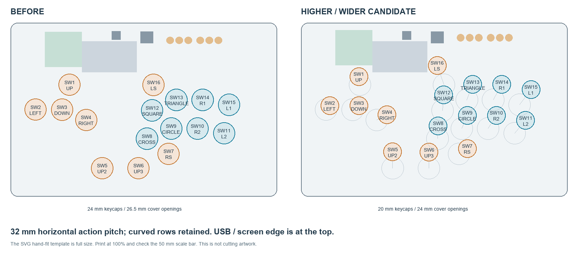

# PHBox higher and wider control layout — 30 October 2026

This is an **ergonomic layout candidate**, with a revised KiCad PCB and matching
case parts. It is separate from the root PCB so that unfinished routing cannot
silently replace the earlier connected board. **Do not fabricate this candidate
until the remaining connections are routed and its final DRC passes.**

## What changed

“Higher” means toward the USB/screen edge in plan view, not taller in Z.
The case remains approximately **292.6 × 191 × 17 mm**, excluding keycaps.

| Item | Before | Revised candidate |
|---|---:|---:|
| Closest centres within the eight main action buttons | 28.84 mm | 32.00 mm |
| Horizontal spacing of action columns | About 28.9 mm | 32 mm |
| Action-row offset | Original stagger | 6 mm horizontal / 34 mm vertical |
| Closest centres across all 16 controls | 28.00 mm | 30.70 mm, between auxiliary SW6 and SW8 |
| Minimum acrylic web between control openings | 1.50 mm | 6.70 mm |
| Palm margin to the nearest keycap | 18.86 mm (24 mm caps) | 38.54 mm (20 mm caps) |
| Screen position | Original | 2 mm toward USB edge |
| Option-button position | Original | 3 mm toward USB edge |

The main action rows move approximately 13–17 mm upward. The two low thumb
buttons SW5/SW6 move approximately 18 mm upward. SW16 moves about 21.4 mm upward
and 7.4 mm left, clearing the unchanged heatsink. Direction buttons move upward
by different amounts to give their new 32 mm spacing without colliding with the
screen. See [every old/new centre](review/button-coordinates.csv) and the
[measured spacing report](checks/layout-metrics.json).

The selected caps are **SGF MonKeys, Choc V2 / Small / Flat / Nekkid, nominal
Ø20 mm**, with **Ø24 mm cover openings**. The 2 mm nominal radial allowance
includes a conservative manufacturing and locator-play allocation. Generic substitutes must
be 20 mm round Choc V2-compatible keycaps with an MX-style cross stem and a
compatible underside/seating depth; a complete panel-mount arcade switch is
not interchangeable with the Choc V2 assembly. Wider spacing is a fit candidate,
not evidence that every hand will prefer it. See the [selected cap specification](keycap-shortlist.md).

**20 mm export status:** the individual top acrylic and its cutting DXF have
been regenerated; model inputs and the full-size hand-fit sheet are updated.
The full `STEP/assembly.step` still contains the earlier cover: its refresh
failed for lack of system memory. Use the individual panel to inspect this
change; the combined assembly and earlier mock jobs are not updated print files.
The **[replacement-only A1 stack](REPRINT_A1/README.md)** now supplies the changed
mock parts and three PLA plug trials as one verified PLA/PETG-interface job.
The saved [DXF preview](review/top_acrylic-cut.png) was visually reviewed.
The STEP snapshot renderer returned blank frames in both attempted display modes;
the panel's native validity and sixteen hole dimensions were checked directly.

## Manufacturing tolerance basis

The [tolerance specification and remaining interfaces](manufacturing-tolerances.md)
separates JLCPCB's published PCB limits from targets for the acrylic, printed
parts and purchased caps. The [conditional cap-opening budget](checks/tolerance-budget.json)
leaves 0.337 mm radial margin with a 24 mm opening, versus a 0.413 mm deficit
with the initially proposed 22.5 mm opening. These figures require the stated
part-size and location targets to be met; they are not a supplier acceptance.
The existing perimeter, plate/heatsink and foam/retainer stack still need
tolerance qualification before the entire case can be released.

Each switch keeps its existing input signal. Its RGB LED, series resistor and
bypass capacitor move by the same translation, preserving their relative
positions and the previously modeled LED-window alignment. No firmware pin
mapping, USB-port placement, MCU/flash placement, heatsink or mounting-hole
positions change.

## Matching case changes

- The top acrylic openings and 14.10 mm Choc V2 retention-plate apertures follow
  the revised PCB centres. Small plate extensions support SW1 and SW16 above
  the former plate edge; the SW16 extension clears the heatsink by 0.6 mm in XY.
- The screen frame, viewing opening, mounting bores/posts and lower relief move
  with the display. A local internal spacer recess clears the frame overhang.
- The option caps and guides follow the **actuator centres**, not pad 1. The
  footprint's actuator is X+2.25 / Y−3.25 mm from its origin at the installed
  rotation. This also corrects the prior case's 0.10 mm Y datum discrepancy.
- The option retainer is 67 × 12 mm, with its two bosses between the button
  groups. Blind internal spacer recesses clear the bosses while retaining the
  outside wall. Its width avoids shading the status-LED bank.
- The lower carrier and foam keepouts follow the moved sockets, components,
  display tails and option-button solder tails. Case columns and foam capture
  tabs retain their original locations.
- Five heatsink vent slots remain. The former X=178 mm slot is omitted because
  it would join the raised SW16 opening. This reduces vent area by one sixth;
  no thermal performance is claimed from the geometry change.
- USB-A's acrylic roof, USB-C's spacer roof and both TPU collars retain the
  previous geometry. The new internal recesses do not open the exterior wall.

## Files to inspect

- [Removable unused-button blanks](button-blanks.md): separate PETG clip-on plugs
  for the current 24 mm main-button holes, with side removal grooves and an
  optional print-fit coupon. Existing enclosure parts do not change for this accessory.
- [Revised PCB](pcb/PHBox-ergonomic.kicad_pcb) and
  [KiCad project](pcb/PHBox-ergonomic.kicad_pro).
- [Installed assembly](STEP/assembly.step) and [PCB reference](reference/board.step).
- [Top acrylic](STEP/top_acrylic.step), [cutting DXF](DXF/top_acrylic.dxf).
- [Switch plate](STEP/switch_plate.step), [cutting DXF](DXF/switch_plate.dxf).
- [Upper spacer](STEP/top_spacer.step), [print mesh](STL/top_spacer.stl).
- [Lower spacer](STEP/bottom_spacer.step), [print mesh](STL/bottom_spacer.stl).
- [Screen frame](STEP/screen_frame.step), [mounts](STEP/mounts.step),
  [option caps](STEP/option_caps.step), [option retainer](STEP/option_retainer.step).
- [Lower foam DXF](DXF/foam.dxf), [upper foam DXF](DXF/upper_foam.dxf).
- [Full-size paper hand-fit sheet](review/hand-fit-template.svg). Print at 100%
  on A3 or tiled A4; verify the 50 mm scale bar. It is not cutting artwork.
- [Plan-view comparison](review/layout-comparison.svg).

The older stacked/individual mock-kit print jobs and 35-step mock manual refer
to the **previous layout**. Use the [new 20-part replacement stack](REPRINT_A1/README.md)
for the changed parts and reuse the unchanged pieces listed there. The earlier
complete-kit jobs, packages and manufacturing exports were not overwritten.

## Other ways to gain room

| Measure | Use here / tradeoff |
|---|---|
| Move the complete input field upward | Primary change. Gains palm space without changing case thickness. All sockets, LEDs, copper and case cuts must follow. |
| Move screen and option buttons toward the rear edge | Applied conservatively. The screen header and mounting drills already approach the PCB edge; further movement needs another edge-clearance and frame-support check. |
| Increase action spacing to 34–36 mm | Possible next candidate, especially with larger caps. Requires revised cover openings, thumb reach and board-edge checks. Do not simply enlarge the holes on this candidate. |
| Adjust curve, stagger or hand angle independently | Can suit finger reach without widening every gap. Preserve easy access to the intended thumb buttons. Check on the paper template first. |
| Increase front case depth | Adds palm support without moving the PCB, at the cost of a larger enclosure. It does not increase button spacing by itself. |
| Move electronics to a smaller rear strip or daughterboard | Can move inputs farther up, but adds a PCB/cabling redesign and disrupts the USB/power/thermal design. Unnecessary for this candidate. |
| Move USB ports or the MCU/flash | Can recover local space but requires new USB routing, seals and heatsink mounts. Kept fixed here. |

[Slagcoin's original layout guide](https://www.slagcoin.com/joystick/layout.html)
discusses proportional spacing, curved rows and palm space, and recommends
trying a full-size printout. Its larger arcade-button dimensions are not Kailh
keycap specifications. [Hit Box's layout explanation](https://www.hitboxarcade.com/blogs/hit-box/hit-box-info-page)
also explains the value of keeping thumb and cross-hand inputs reachable;
more separation has a reach tradeoff.

## Checks and limits

**Direct button follow-up:** modeled switches and option caps clear the screen
and heatsink. The selected 20 mm diameter removes the previous 24 mm SW16
keycap's projected overlap with the heatsink. Full-stroke fit of a purchased
cap still needs its actual underside/seating dimensions and a trial press.
See the [button-to-component review](button-clearance-review.md) and
[selected cap specification](keycap-shortlist.md).

- The original PCB baseline has zero electrical DRC errors/unconnected items,
  with two existing silkscreen warnings. The candidate retains its pin-to-net
  assignments and outline; see [placement changes](checks/placement-changes.json).
- The preceding [saved geometry checks](fit-check.json) cover the unchanged PCB, case parts, mounting
  hardware and ±0.25 mm Z travel. [Option-cap checks](option-caps-check.json)
  cover assumed button stroke and guide play. [USB integration checks](port-integration-check.json)
  and [DXF audit](cut-check.json) cover the retained port surround and cut files.
  [Selected-cap checks](checks/selected-caps.json) supersede the earlier cover
  dimensions and check the current panel's added material at ±0.41 mm Z and
  the stated sampled XY poses; they do not update the combined STEP assembly.
- [Aperture/extension checks](checks/layout-geometry.json) confirm closed
  3 mm lands around all switch-plate apertures and separate cover openings.
  Both new plate extensions clear the heatsink by at least 0.6 mm. The whole
  plate's closest clearance is 0.302 mm at the existing H7 relief; allow for
  actual cutting tolerances and verify that existing interface on the trial.
- Mechanical checks concern nominal geometry. Real keycaps, actual option-switch
  height/stroke, foam force, threaded retention, acrylic strength and thermal
  behaviour still require physical trials. Existing heatsink screw engagement
  remains unresolved; this layout does not resolve it.
- Electrical rerouting and final release status are tracked separately below.
  SPICE/ERC were not rerun for this placement task; circuit values and pin nets
  did not change. A mock-only replacement print job is supplied separately;
  no new PCB manufacturing package or production fabrication release was made.

## PCB routing status

Placement and matching case geometry are complete. The saved PCB candidate has
**zero electrical clearance errors, 22 unconnected items and 182 warnings** after
a KiCad zone refill. Warnings comprise 82 dangling tracks, 6 dangling vias,
66 silkscreen overlaps and 28 silkscreen/copper overlaps. These need triage as
part of routing completion; a lack of clearance errors does not mean a connected
or fabrication-ready board. The bounded completion pass did not finish the PCB.
See the [candidate DRC](checks/candidate-drc.json) and [independent PCB audit](checks/pcb-audit.json).

All 146 footprint pin maps match the source; 71 footprints move and 75 retain
their exact positions. All 1,117 selected fixed electronics/core copper items
retain their original geometry and net assignment. The audit caught a net
assignment changed by the routing import on one retained RGB track; its original
net was restored, increasing the remaining connection count from 21 to 22.
The earlier root board is unchanged. The candidate still needs manual or
constrained routing completion, dangling-copper cleanup, silkscreen triage and
another final DRC before manufacturing outputs can be regenerated.

The local 3D viewer did not become ready during this session. The saved STEP
files and reviewed images remain available above.

## Rebuild

`layout.json` defines the placement revision. `build_pcb.py` uses KiCad's Python
to create the initial candidate from `pcb/before.kicad_pcb`; it intentionally
clears affected copper and is not the final routing step. Do not run it over a
manually completed routing revision without preserving that revision first.

`extract_constraints.py` reads the candidate PCB for CAD. `prepare_case.py`
derives this revision's editable factories from the previous mechanical sources.
Run the source models with the existing CAD environment and local CAD cache;
`src/assembly.py` composes them. Run the checks in `checks/` and
`review_layout.py` after changing positions. Do not use the old mock print
coordinates as assembly positions.
