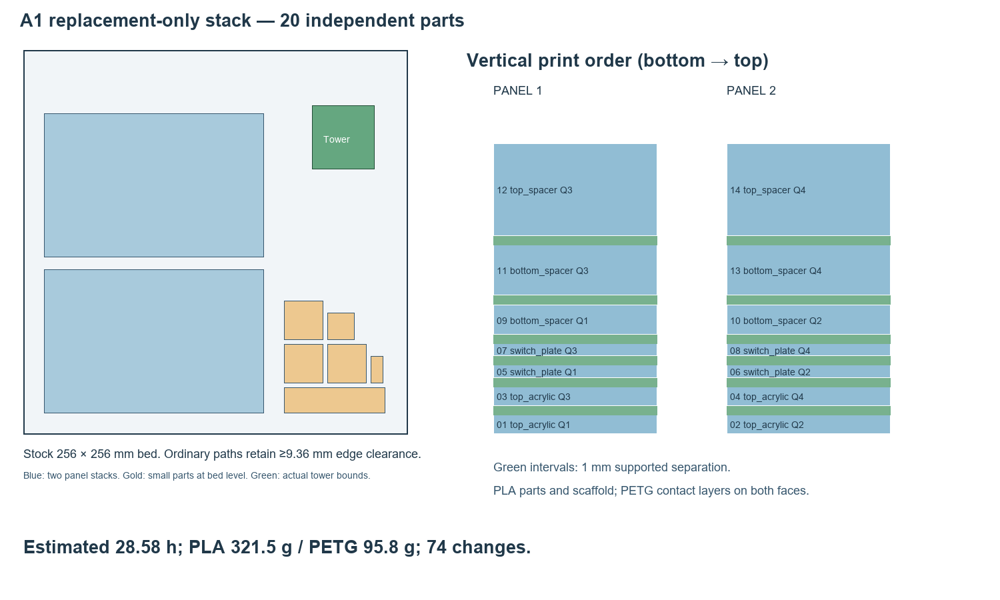

# A1 replacement-only vertical print job

30 October 2026. **PLA for every model, including the three blanking plugs. PETG
is used only for release interfaces.** This replaces the changed pieces of the
older mock kit; it does not reprint all 105 old parts. No printer was contacted
and no print was started.

## Files and print setup

1. Review [reprint_stack_project.3mf](reprint_stack_project.3mf), the editable
   native Bambu Studio project. Keep its **single multipart assembly intact**;
   do not auto-arrange, split into independently bed-dropped objects, or scale it.
   All 20 parts remain individually named components inside that assembly.
2. The print file is **[reprint_stack.gcode.3mf](reprint_stack.gcode.3mf)**.
   It was sliced using the installed **Bambu Studio only**, for **Bambu A1,
   0.4 mm standard stainless nozzle, Textured PEI, AMS Lite, by-layer printing**.
   Check those settings and map PLA / PETG to their actual AMS slots in the app.
   Confirm a clear bed and inspect the first layer when starting manually.
3. Estimated **28 h 35 min**, **321.5 g PLA +
   95.8 g PETG**, including supports, tower and purge;
   **74 AMS changes**. Have approximately **400 g PLA / 125 g PETG**
   available for this job with margin. Actual usage and time can differ.

The 14 panel/frame sections form two independently rising stacks. Six small
parts use the otherwise empty right-hand bed pocket. Source height is **31.05 mm**.
The supported gaps are **1 mm**, with two PETG contact layers on both model-facing
support faces and PLA scaffold between them where space permits. The blank clips
also have PETG support beneath their curved arms. PETG release paths were verified
at actual stepped carrier surfaces, not just overall bounding-box heights.

The rearrangement saves **2.36 hours and 53.1 g**
versus the first replacement slice without altering part geometry: broad carrier
floors sit below tall upper-spacer cavities. [Comparison](review/ordering-comparison.json).

## Included replacement parts

- Four top-cover surrogate quarters, four switch-plate quarters and four lower-spacer quarters.
- Upper-spacer quarters **3 and 4** and one option retainer.
- Lower foam-height gauges **1 and 7**, plus **three PLA blanking-plug trials**.

Reuse the old bottom-cover quarters, upper-spacer quarters 1/2, screen frame and
small mounts, six option plungers, heatsink surrogate/mounting parts, case posts,
washers and USB collars. The two retained upper-spacer quarters were compared
against the old native CAD; both added/removed volumes are zero in
[manifest.json](manifest.json). Actual lower foam pads 1/7 need revised cuts;
the printed gauges below are rigid substitutes and do not damp the PCB.

| ID in layout | Individual replacement mesh | Placement | Base Z (mm) |
|---|---|---|---:|
| 01 | [top_acrylic_SURROGATE_QUARTER_1.stl](STL/top_acrylic_SURROGATE_QUARTER_1.stl) | panel 1 | 0.00 |
| 02 | [top_acrylic_SURROGATE_QUARTER_2.stl](STL/top_acrylic_SURROGATE_QUARTER_2.stl) | panel 2 | 0.00 |
| 03 | [top_acrylic_SURROGATE_QUARTER_3.stl](STL/top_acrylic_SURROGATE_QUARTER_3.stl) | panel 1 | 3.00 |
| 04 | [top_acrylic_SURROGATE_QUARTER_4.stl](STL/top_acrylic_SURROGATE_QUARTER_4.stl) | panel 2 | 3.00 |
| 05 | [switch_plate_QUARTER_1.stl](STL/switch_plate_QUARTER_1.stl) | panel 1 | 6.00 |
| 06 | [switch_plate_QUARTER_2.stl](STL/switch_plate_QUARTER_2.stl) | panel 2 | 6.00 |
| 07 | [switch_plate_QUARTER_3.stl](STL/switch_plate_QUARTER_3.stl) | panel 1 | 8.30 |
| 08 | [switch_plate_QUARTER_4.stl](STL/switch_plate_QUARTER_4.stl) | panel 2 | 8.30 |
| 09 | [bottom_spacer_QUARTER_1.stl](STL/bottom_spacer_QUARTER_1.stl) | panel 1 | 10.60 |
| 10 | [bottom_spacer_QUARTER_2.stl](STL/bottom_spacer_QUARTER_2.stl) | panel 2 | 10.60 |
| 11 | [bottom_spacer_QUARTER_3.stl](STL/bottom_spacer_QUARTER_3.stl) | panel 1 | 14.80 |
| 12 | [top_spacer_QUARTER_3.stl](STL/top_spacer_QUARTER_3.stl) | panel 1 | 21.20 |
| 13 | [bottom_spacer_QUARTER_4.stl](STL/bottom_spacer_QUARTER_4.stl) | panel 2 | 14.80 |
| 14 | [top_spacer_QUARTER_4.stl](STL/top_spacer_QUARTER_4.stl) | panel 2 | 21.20 |
| 15 | [option_retainer.stl](STL/option_retainer.stl) | bed pocket | 0.00 |
| 16 | [button_blank_PLA_trial_1.stl](STL/button_blank_PLA_trial_1.stl) | bed pocket | 0.00 |
| 17 | [button_blank_PLA_trial_2.stl](STL/button_blank_PLA_trial_2.stl) | bed pocket | 0.00 |
| 18 | [button_blank_PLA_trial_3.stl](STL/button_blank_PLA_trial_3.stl) | bed pocket | 0.00 |
| 19 | [pad_1_7_INSTALLED_HEIGHT_GAUGE.stl](STL/pad_1_7_INSTALLED_HEIGHT_GAUGE.stl) | bed pocket | 0.00 |
| 20 | [pad_1_1_INSTALLED_HEIGHT_GAUGE.stl](STL/pad_1_1_INSTALLED_HEIGHT_GAUGE.stl) | bed pocket | 0.00 |

Quarter seams have no new interlocks. Reassemble them on a flat jig and tape
the reverse faces temporarily; [raw source bounds](manifest.json) identify the
original section positions. They do not reproduce full-panel stiffness.

## Presets, support and materials

0.10 mm model and first layers; two walls; 10% infill; four top / three bottom
layers. PLA 220 °C, conservative Bambu PETG interface 245 °C / 8 mm³/s, bed 65 °C.
The exact Bambu PLA grade and PETG Basic/HF variant remain unconfirmed. These are
the existing fitment starting profiles, not measured flow calibration.

PETG interfaces use zero top/bottom contact Z gap and zero interface spacing;
supports may start on earlier parts. Prime tower is enabled at X196/Y180,
35 mm width, with 800 mm³ flushing per material-change direction. No flushing
into models, infill or supports. Let the plate cool, then separate the layers
carefully and clear all support from the plug-arm gaps and fingernail grooves.
If support release has not been trialled, use the earlier small separator trial
before committing to a long stack.

| Estimated category | PLA | PETG |
|---|---:|---:|
| Models and adhesion brim | 183.9 g | 0.0 g |
| Support scaffold and transition | 80.2 g | 0.0 g |
| Release interfaces | 0.0 g | 53.4 g |
| Prime tower | 22.1 g | 6.7 g |
| Purge and material-change waste (inferred) | 35.3 g | 35.6 g |
| **Total** | **321.5 g** | **95.8 g** |

Tower is measured from deposited extrusion; purge is inferred from slicer total
minus main material minus tower. These are estimates, not weighed consumption.
See [material breakdown](review/material-breakdown.json).

## Verification and limits

- All twenty STLs are watertight, finite, bed-oriented and match native dimensions
  within 0.02 mm; [mesh check](review/mesh-check.json). The source CAD inventory was
  rendered and reviewed in [replacement-parts.png](review/replacement-parts.png).
- The saved slice retains twenty named parts and their source geometry hashes;
  maximum native placement deviation **0.001444 mm**.
  [Geometry/settings/interfaces](review/verification.json).
- Every elevated section has PETG below it, and both faces of the panel-stack
  gaps have release-interface paths. This proves path presence, not exhaustive
  underside coverage or successful physical separation.
- Generated travel including full circular extrema stays at least **9.36 mm**
  inside the stock 256 mm bed. Deposition including line width has at least
  **10.045 mm** edge margin. The required check margin was 5 mm.
  [Full bounds audit](review/bounds-audit.json).
- Stock A1 start/change/end service templates are unchanged. Their expected
  off-bed wiping/loading/parking moves are reported separately; no machine
  boundary was enlarged or disabled. [Independent file inspection](review/file-inspection.json)
  confirms A1 / 0.4 mm / PLA+PETG / Textured PEI; it is not printer telemetry.
- The saved Bambu [isometric](review/plate_1.png) and [top](review/top_1.png)
  previews were reviewed for placement. They show model geometry; the G-code
  audit separately checks generated support, tower and travel paths.

This is an **unpowered fitment mock**, including rigid foam gauges and PLA plug
trials. PLA clips are not a repeated-removal durability qualification. For each
plug, remove the keycap, orient the grooves left/right (especially at SW16),
clear support from both curved arms, then press evenly into the new 24 mm opening.
The switch may remain fitted if its real height matches the checked model.
Real hardware, support release, material tolerance,
foam preload and thermal performance remain physical-trial requirements.
The wider PCB is still an unrouted candidate, not a fabrication release.
