# PHBox printed mock: illustrated assembly

[Open the illustrated PDF](output/pdf/PHBox_mock_assembly_manual.pdf).

Use the printed mock unpowered. Rigid collar gauges are removed before closing over the coarse USB blocks. Printed fastener models have no functional threads.

## 01. Join the bottom panel

Keep the four cut faces together on a flat jig. Put the countersinks on the outside, facing down.

**Check:** Q3 / Q4 face the USB edge; Q1 / Q2 face the opposite edge.

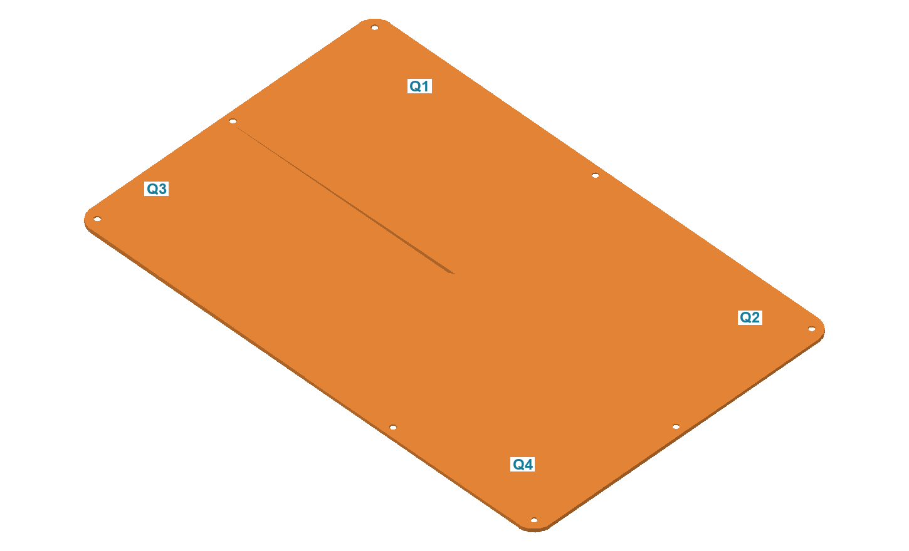

**B01: Bottom panel quarters, 4 pieces**

- [bottom_acrylic_SURROGATE_QUARTER_1.stl](STL/bottom_acrylic_SURROGATE_QUARTER_1.stl)
- [bottom_acrylic_SURROGATE_QUARTER_2.stl](STL/bottom_acrylic_SURROGATE_QUARTER_2.stl)
- [bottom_acrylic_SURROGATE_QUARTER_3.stl](STL/bottom_acrylic_SURROGATE_QUARTER_3.stl)
- [bottom_acrylic_SURROGATE_QUARTER_4.stl](STL/bottom_acrylic_SURROGATE_QUARTER_4.stl)

## 02. Place the lower washers

Place one lower 0.5 mm washer at each of the eight case-column positions.

**Check:** Count 8. Keep washers flat; do not put them under the PCB.

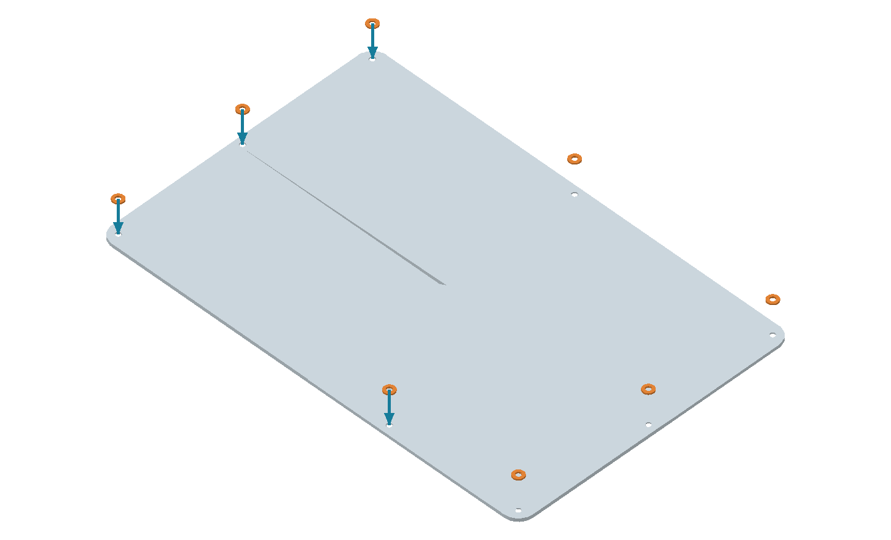

**W01: Lower case washers, 8 pieces**

- [acrylic_case_washer_1_bottom_0p5_SURROGATE.stl](STL/acrylic_case_washer_1_bottom_0p5_SURROGATE.stl)
- [acrylic_case_washer_2_bottom_0p5_SURROGATE.stl](STL/acrylic_case_washer_2_bottom_0p5_SURROGATE.stl)
- [acrylic_case_washer_3_bottom_0p5_SURROGATE.stl](STL/acrylic_case_washer_3_bottom_0p5_SURROGATE.stl)
- [acrylic_case_washer_4_bottom_0p5_SURROGATE.stl](STL/acrylic_case_washer_4_bottom_0p5_SURROGATE.stl)
- [acrylic_case_washer_5_bottom_0p5_SURROGATE.stl](STL/acrylic_case_washer_5_bottom_0p5_SURROGATE.stl)
- [acrylic_case_washer_6_bottom_0p5_SURROGATE.stl](STL/acrylic_case_washer_6_bottom_0p5_SURROGATE.stl)
- [acrylic_case_washer_7_bottom_0p5_SURROGATE.stl](STL/acrylic_case_washer_7_bottom_0p5_SURROGATE.stl)
- [acrylic_case_washer_8_bottom_0p5_SURROGATE.stl](STL/acrylic_case_washer_8_bottom_0p5_SURROGATE.stl)

## 03. Stand the case posts on the washers

Place the eight 12 mm posts on their lower washers. Hold them temporarily if needed.

**Check:** Printed 2.5 mm bores are unthreaded. Do not drive M3 screws into them.

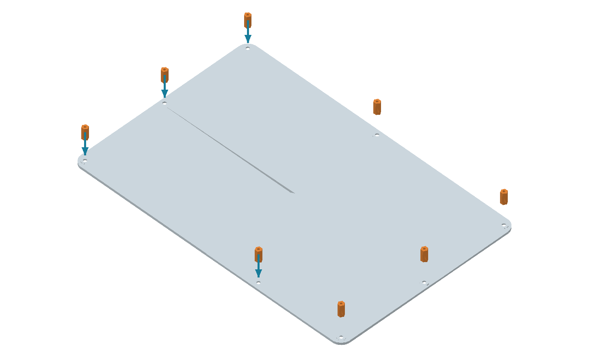

**C01: 12 mm case posts, 8 pieces**

- [acrylic_case_post_1_12mm_AF5_SURROGATE.stl](STL/acrylic_case_post_1_12mm_AF5_SURROGATE.stl)
- [acrylic_case_post_2_12mm_AF5_SURROGATE.stl](STL/acrylic_case_post_2_12mm_AF5_SURROGATE.stl)
- [acrylic_case_post_3_12mm_AF5_SURROGATE.stl](STL/acrylic_case_post_3_12mm_AF5_SURROGATE.stl)
- [acrylic_case_post_4_12mm_AF5_SURROGATE.stl](STL/acrylic_case_post_4_12mm_AF5_SURROGATE.stl)
- [acrylic_case_post_5_12mm_AF5_SURROGATE.stl](STL/acrylic_case_post_5_12mm_AF5_SURROGATE.stl)
- [acrylic_case_post_6_12mm_AF5_SURROGATE.stl](STL/acrylic_case_post_6_12mm_AF5_SURROGATE.stl)
- [acrylic_case_post_7_12mm_AF5_SURROGATE.stl](STL/acrylic_case_post_7_12mm_AF5_SURROGATE.stl)
- [acrylic_case_post_8_12mm_AF5_SURROGATE.stl](STL/acrylic_case_post_8_12mm_AF5_SURROGATE.stl)

## 04. Place the lower spacer quarters

Place Q1-Q4 around the case posts. Align the butt seams and the board-support ledges.

**Check:** Keep seam tape away from washer seats, foam ledges and guides.

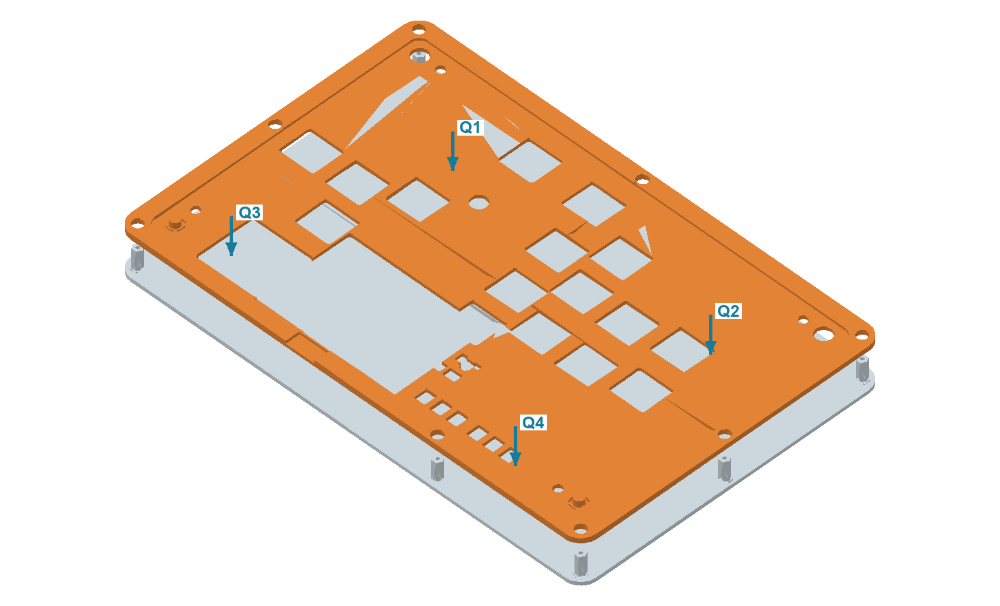

**B02: Lower spacer quarters, 4 pieces**

- [bottom_spacer_QUARTER_1.stl](STL/bottom_spacer_QUARTER_1.stl)
- [bottom_spacer_QUARTER_2.stl](STL/bottom_spacer_QUARTER_2.stl)
- [bottom_spacer_QUARTER_3.stl](STL/bottom_spacer_QUARTER_3.stl)
- [bottom_spacer_QUARTER_4.stl](STL/bottom_spacer_QUARTER_4.stl)

## 05. Place the seven lower height gauges

Place the seven rigid lower gauges on their relieved support ledges.

**Check:** For a floating-board test, use real foam instead. Do not stack foam on these gauges.

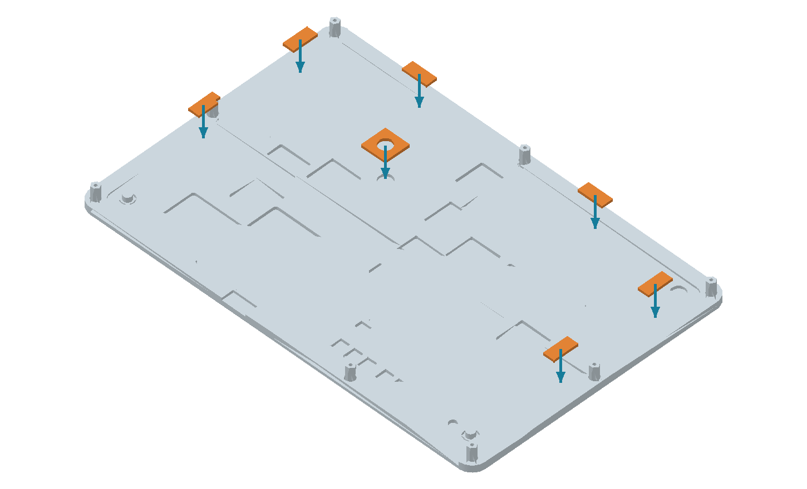

**F01: Lower height gauges, 7 pieces**

- [pad_1_1_INSTALLED_HEIGHT_GAUGE.stl](STL/pad_1_1_INSTALLED_HEIGHT_GAUGE.stl)
- [pad_1_2_INSTALLED_HEIGHT_GAUGE.stl](STL/pad_1_2_INSTALLED_HEIGHT_GAUGE.stl)
- [pad_1_3_INSTALLED_HEIGHT_GAUGE.stl](STL/pad_1_3_INSTALLED_HEIGHT_GAUGE.stl)
- [pad_1_4_INSTALLED_HEIGHT_GAUGE.stl](STL/pad_1_4_INSTALLED_HEIGHT_GAUGE.stl)
- [pad_1_5_INSTALLED_HEIGHT_GAUGE.stl](STL/pad_1_5_INSTALLED_HEIGHT_GAUGE.stl)
- [pad_1_6_INSTALLED_HEIGHT_GAUGE.stl](STL/pad_1_6_INSTALLED_HEIGHT_GAUGE.stl)
- [pad_1_7_INSTALLED_HEIGHT_GAUGE.stl](STL/pad_1_7_INSTALLED_HEIGHT_GAUGE.stl)

## 06. Join the PCB surrogate quarters

On a separate flat jig, join the four PCB quarters with the raised package boxes facing up.

**Check:** The USB blocks identify the USB edge. This is not a working PCB.

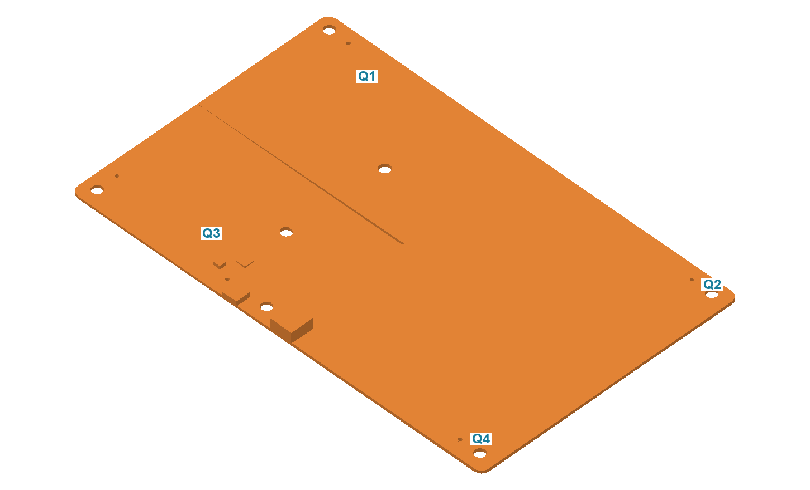

**P01: PCB surrogate quarters, 4 pieces**

- [PCB_SELECTED_ENVELOPES_SURROGATE_QUARTER_1.stl](STL/PCB_SELECTED_ENVELOPES_SURROGATE_QUARTER_1.stl)
- [PCB_SELECTED_ENVELOPES_SURROGATE_QUARTER_2.stl](STL/PCB_SELECTED_ENVELOPES_SURROGATE_QUARTER_2.stl)
- [PCB_SELECTED_ENVELOPES_SURROGATE_QUARTER_3.stl](STL/PCB_SELECTED_ENVELOPES_SURROGATE_QUARTER_3.stl)
- [PCB_SELECTED_ENVELOPES_SURROGATE_QUARTER_4.stl](STL/PCB_SELECTED_ENVELOPES_SURROGATE_QUARTER_4.stl)

## 07. Fit the switch-plate front stops

Place the three front stops at H1, H2 and H3. Seat their locating pilots in the board holes.

**Check:** These are the three 3 mm switch-plate seats, not the case columns.

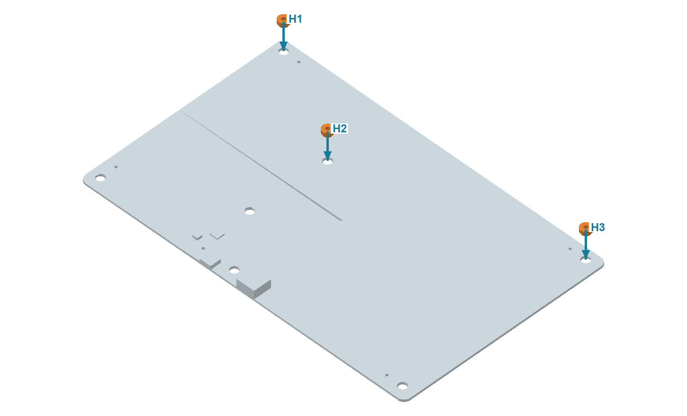

**M01: Switch-plate front stops, 3 pieces**

- [insulating_plate_stop_H1.stl](STL/insulating_plate_stop_H1.stl)
- [insulating_plate_stop_H2.stl](STL/insulating_plate_stop_H2.stl)
- [insulating_plate_stop_H3.stl](STL/insulating_plate_stop_H3.stl)

## 08. Position the switch-plate rear caps

View from underneath: place a matching rear cap at H1, H2 and H3. Hold it temporarily.

**Check:** No threads are modeled. Use tape or gentle external support; do not force a screw.

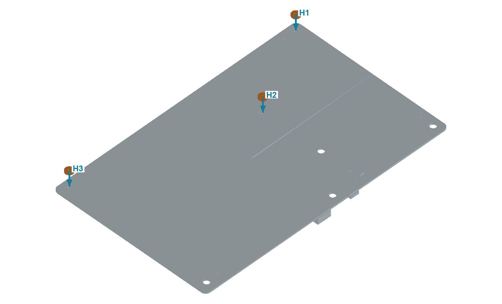

**M02: Switch-plate rear caps, 3 pieces**

- [insulating_plate_rear_tapped_cap_H1.stl](STL/insulating_plate_rear_tapped_cap_H1.stl)
- [insulating_plate_rear_tapped_cap_H2.stl](STL/insulating_plate_rear_tapped_cap_H2.stl)
- [insulating_plate_rear_tapped_cap_H3.stl](STL/insulating_plate_rear_tapped_cap_H3.stl)

## 09. Place the switch-plate quarters

Align all four switch-plate quarters on the three front stops. Keep their cut edges together.

**Check:** The nominal plate is 1.30 mm thick. Test real switches off the PCB surrogate.

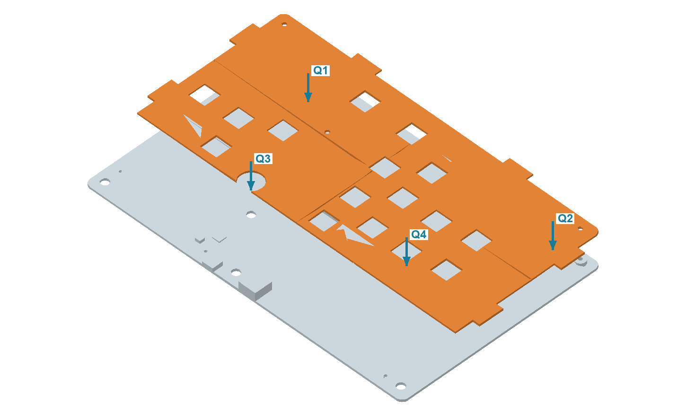

**P02: Switch-plate quarters, 4 pieces**

- [switch_plate_QUARTER_1.stl](STL/switch_plate_QUARTER_1.stl)
- [switch_plate_QUARTER_2.stl](STL/switch_plate_QUARTER_2.stl)
- [switch_plate_QUARTER_3.stl](STL/switch_plate_QUARTER_3.stl)
- [switch_plate_QUARTER_4.stl](STL/switch_plate_QUARTER_4.stl)

## 10. Position the heatsink front stops

Place the heatsink stops at H5, H7 and H12. Match the smaller H12 stop to H12.

**Check:** H5/H7 use the larger stop. Do not swap them with the switch-plate stops.

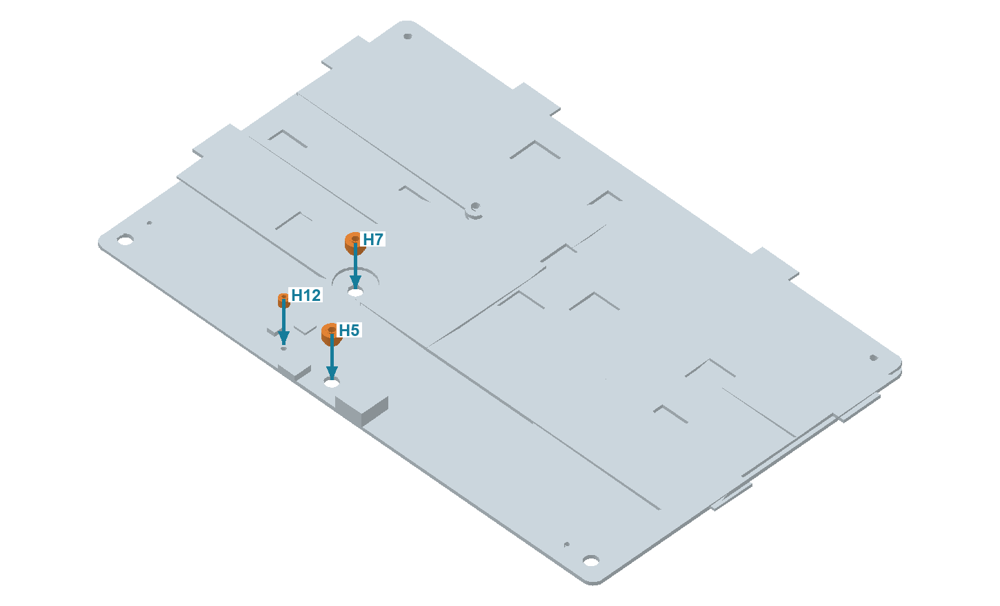

**H01: Heatsink front stops, 3 pieces**

- [custom_POM_stop_H12.stl](STL/custom_POM_stop_H12.stl)
- [custom_POM_stop_H5.stl](STL/custom_POM_stop_H5.stl)
- [custom_POM_stop_H7.stl](STL/custom_POM_stop_H7.stl)

## 11. Add the heatsink support washers

Place each support washer on its matching recessed heatsink-stop seat.

**Check:** Match H5, H7 and H12. Keep the thermal contact bosses clear.

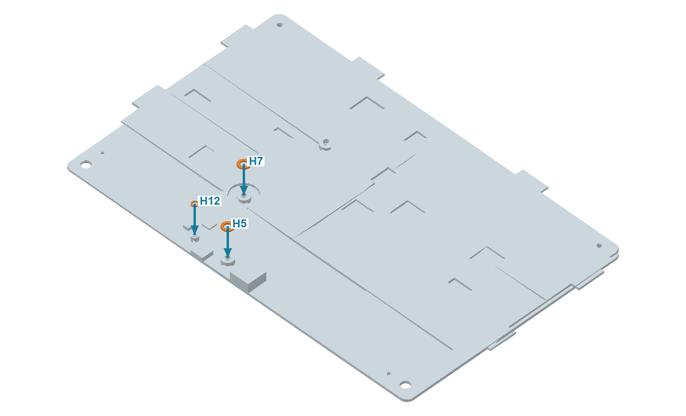

**H02: Heatsink support washers, 3 pieces**

- [insulating_support_washer_H12.stl](STL/insulating_support_washer_H12.stl)
- [insulating_support_washer_H5.stl](STL/insulating_support_washer_H5.stl)
- [insulating_support_washer_H7.stl](STL/insulating_support_washer_H7.stl)

## 12. Position the heatsink rear washers

View from underneath: place the three relieved rear washers at H5, H7 and H12.

**Check:** They are rear washers, not the front support washers.

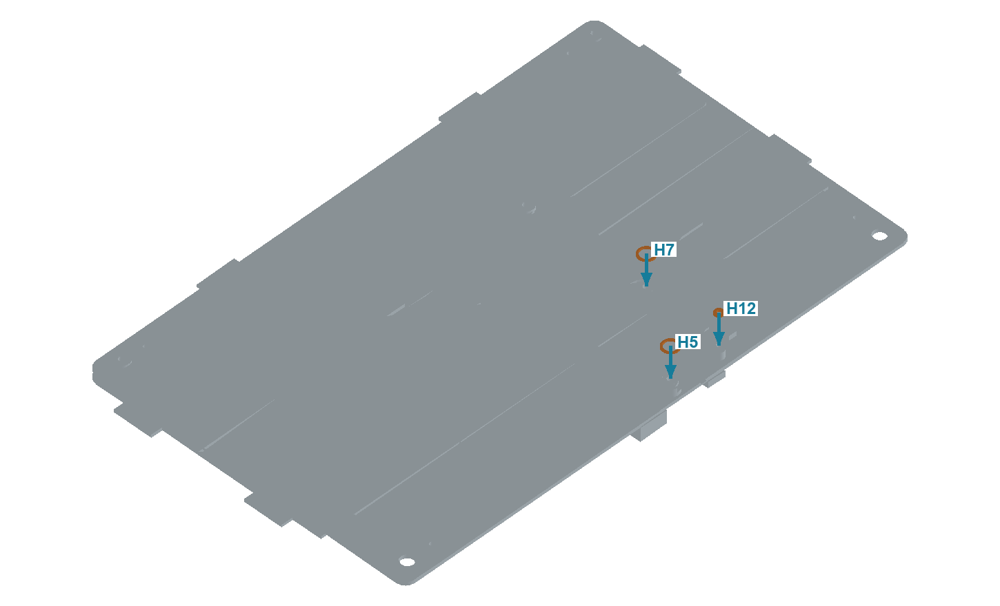

**H03: Heatsink rear washers, 3 pieces**

- [rear_insulating_washer_H12.stl](STL/rear_insulating_washer_H12.stl)
- [rear_insulating_washer_H5.stl](STL/rear_insulating_washer_H5.stl)
- [rear_insulating_washer_H7.stl](STL/rear_insulating_washer_H7.stl)

## 13. Position the heatsink rear retainers

Place each retainer behind its matching rear washer. Hold the stack temporarily.

**Check:** Retainers are threadless proxies. Final heatsink screw lengths remain unresolved.

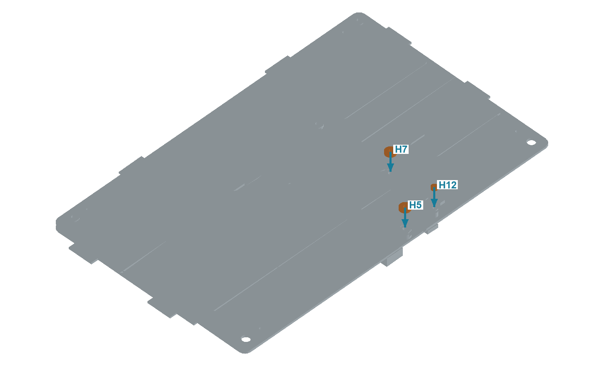

**H04: Heatsink rear retainers, 3 pieces**

- [custom_POM_retainer_thread_not_modeled_H12.stl](STL/custom_POM_retainer_thread_not_modeled_H12.stl)
- [custom_POM_retainer_thread_not_modeled_H5.stl](STL/custom_POM_retainer_thread_not_modeled_H5.stl)
- [custom_POM_retainer_thread_not_modeled_H7.stl](STL/custom_POM_retainer_thread_not_modeled_H7.stl)

## 14. Place the two thermal height gauges

Place the larger gauge on the MCU envelope and the smaller gauge on the flash envelope.

**Check:** Rigid gauges only: use either these or real thermal pads, never both.

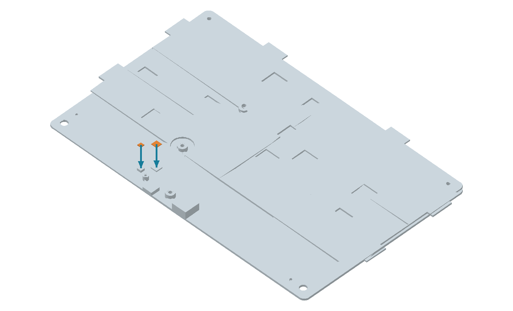

**T01: MCU + flash height gauges, 2 pieces**

- [pad_8_1_INSTALLED_HEIGHT_GAUGE.stl](STL/pad_8_1_INSTALLED_HEIGHT_GAUGE.stl)
- [pad_9_1_INSTALLED_HEIGHT_GAUGE.stl](STL/pad_9_1_INSTALLED_HEIGHT_GAUGE.stl)

## 15. Lower the heatsink surrogate

Turn the printed heatsink so its thermal bosses face down. Lower it onto the stops and gauges.

**Check:** The notch faces BOOTSEL/RESET. Never power the board with this plastic heatsink.

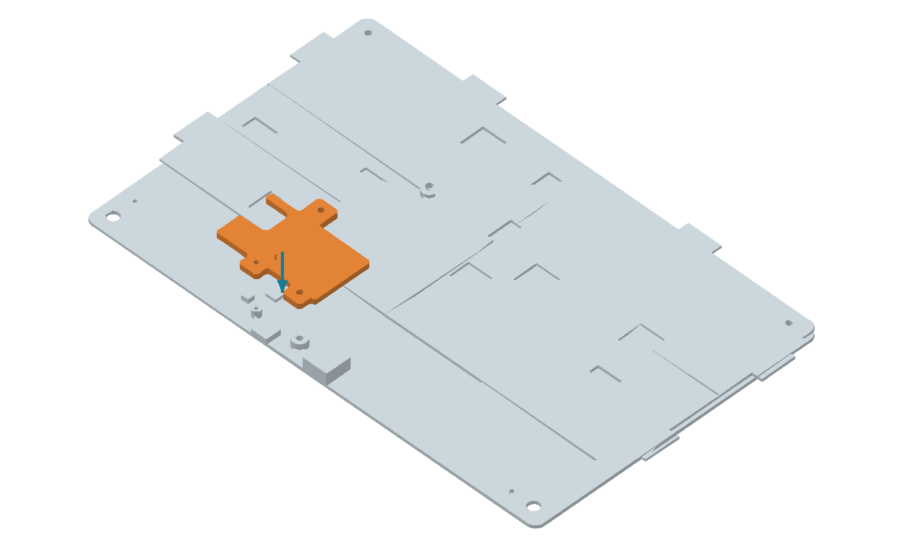

**H05: Heatsink surrogate, 1 pieces**

- [aluminium_heatsink_SURROGATE.stl](STL/aluminium_heatsink_SURROGATE.stl)

## 16. Fit the four screen front posts

Place the four screen posts in their PCB mounting holes, with the 3 mm seating faces upward.

**Check:** Use the four small screen posts. The switch-plate stops are larger.

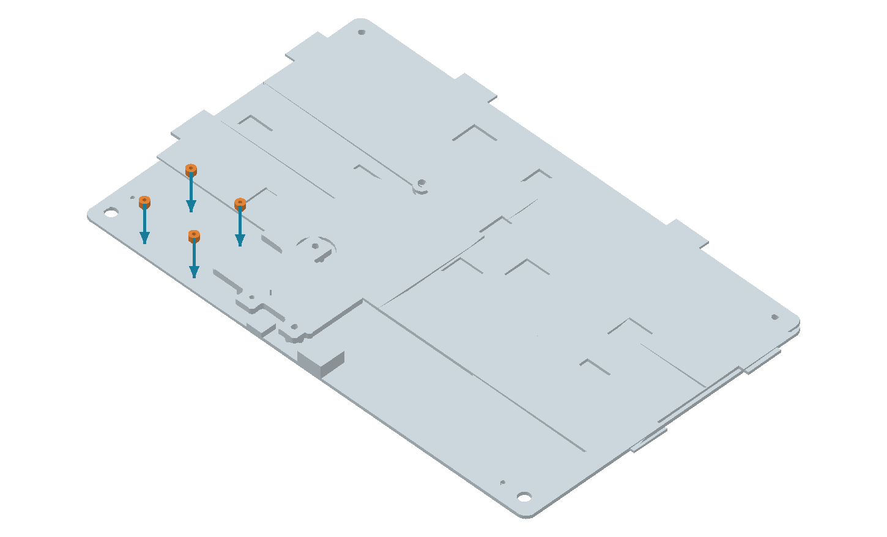

**S01: Screen front posts, 4 pieces**

- [printed_screen_stop_1_3mm.stl](STL/printed_screen_stop_1_3mm.stl)
- [printed_screen_stop_2_3mm.stl](STL/printed_screen_stop_2_3mm.stl)
- [printed_screen_stop_3_3mm.stl](STL/printed_screen_stop_3_3mm.stl)
- [printed_screen_stop_4_3mm.stl](STL/printed_screen_stop_4_3mm.stl)

## 17. Position the four screen rear caps

View from underneath: place one screen rear cap at each of the four screen-post holes.

**Check:** Temporarily hold the caps. They do not provide tested threaded retention.

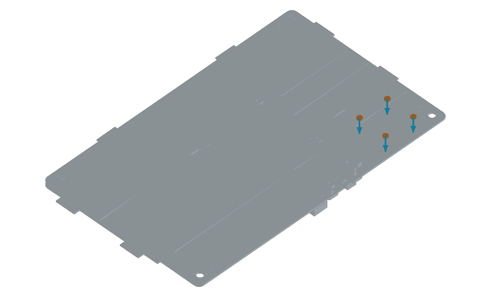

**S02: Screen rear caps, 4 pieces**

- [printed_screen_rear_tapped_cap_1_M2.stl](STL/printed_screen_rear_tapped_cap_1_M2.stl)
- [printed_screen_rear_tapped_cap_2_M2.stl](STL/printed_screen_rear_tapped_cap_2_M2.stl)
- [printed_screen_rear_tapped_cap_3_M2.stl](STL/printed_screen_rear_tapped_cap_3_M2.stl)
- [printed_screen_rear_tapped_cap_4_M2.stl](STL/printed_screen_rear_tapped_cap_4_M2.stl)

## 18. Place the OLED PCB surrogate

Place the OLED board surrogate on its four screen posts and align all four corner holes.

**Check:** This model omits the display glass, header and pin tails.

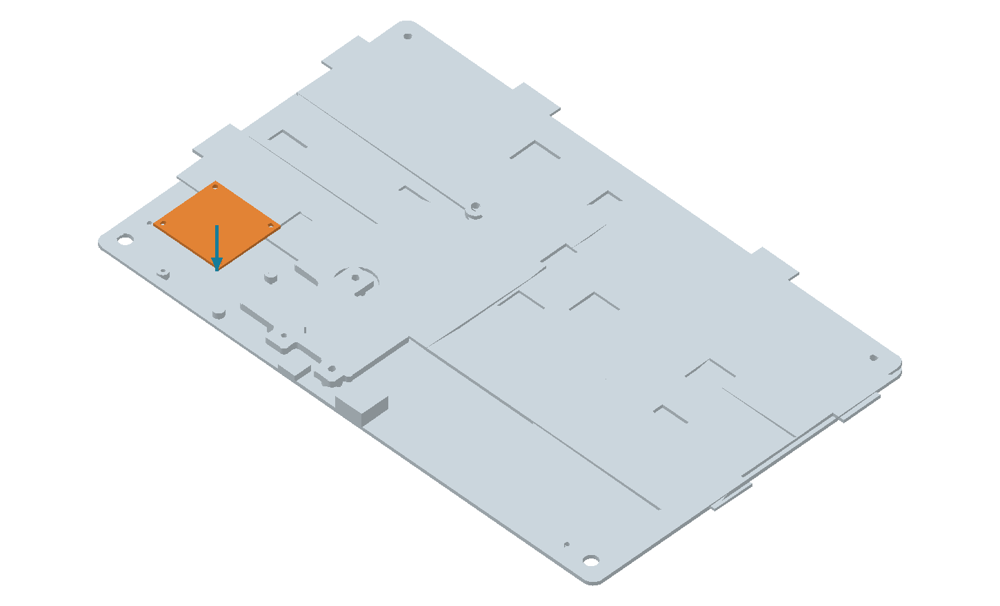

**S03: OLED PCB surrogate, 1 pieces**

- [OLED_MODULE_PCB_SURROGATE.stl](STL/OLED_MODULE_PCB_SURROGATE.stl)

## 19. Place the screen retaining frame

Place the frame above the OLED board, aligning the four corner mounting positions.

**Check:** The ears retain PCB corners. Do not use a real display glass surface as a clamping seat.

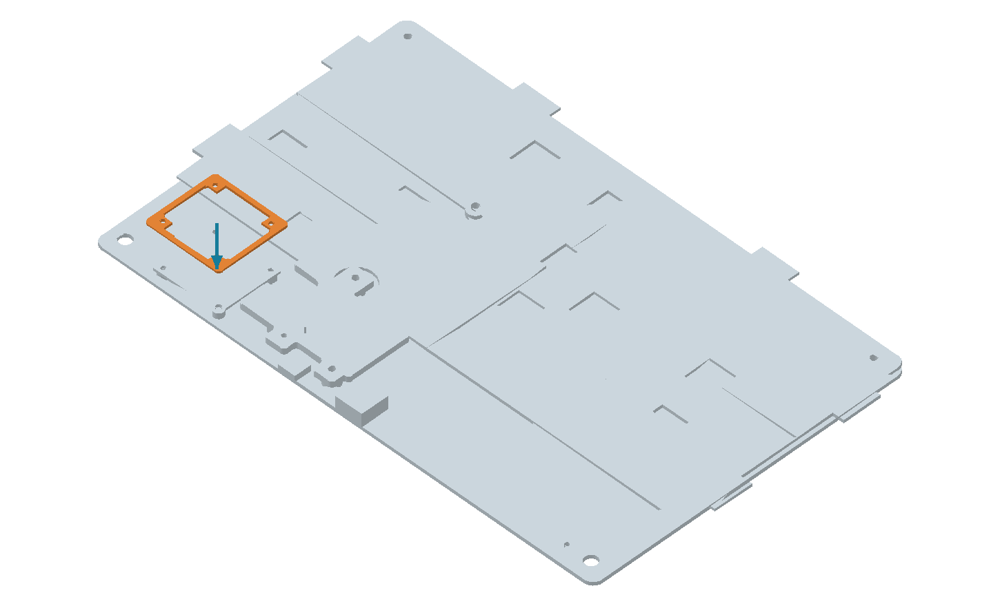

**S04: Screen retaining frame, 1 pieces**

- [screen_frame.stl](STL/screen_frame.stl)

## 20. Join the top panel quarters

On a separate flat jig, join the top-panel quarters. Keep countersinks on the outside face.

**Check:** Do not attach the top panel to the lower case yet.

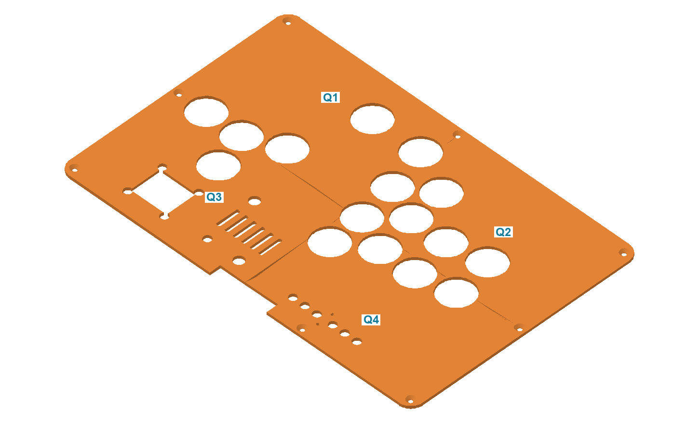

**L01: Top panel quarters, 4 pieces**

- [top_acrylic_SURROGATE_QUARTER_1.stl](STL/top_acrylic_SURROGATE_QUARTER_1.stl)
- [top_acrylic_SURROGATE_QUARTER_2.stl](STL/top_acrylic_SURROGATE_QUARTER_2.stl)
- [top_acrylic_SURROGATE_QUARTER_3.stl](STL/top_acrylic_SURROGATE_QUARTER_3.stl)
- [top_acrylic_SURROGATE_QUARTER_4.stl](STL/top_acrylic_SURROGATE_QUARTER_4.stl)

## 21. Insert the six option caps

From below the top panel, insert the six guided cap bodies upward through their openings.

**Check:** The wide retaining flanges stay beneath the panel. Contact tips point toward the PCB.

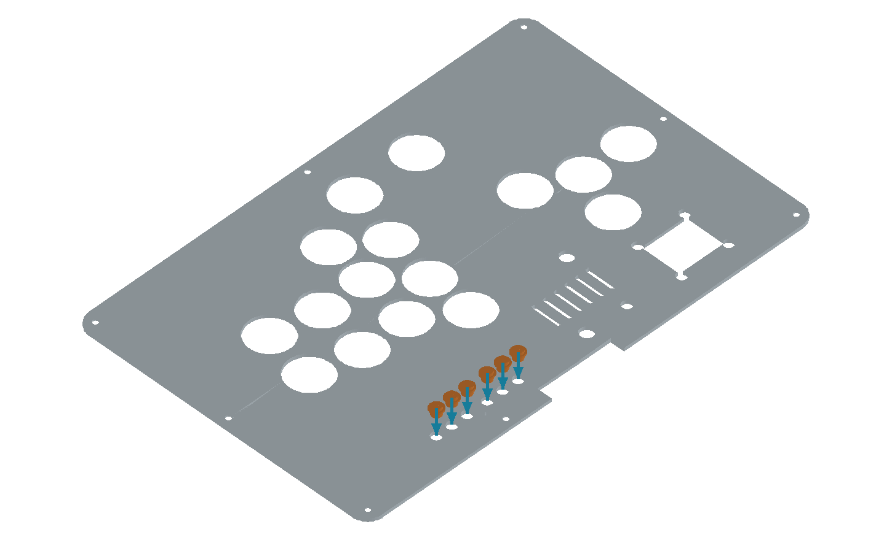

**O01: Option-button caps, 6 pieces**

- [OPSW1_captive_cap_H5_trial.stl](STL/OPSW1_captive_cap_H5_trial.stl)
- [OPSW2_captive_cap_H5_trial.stl](STL/OPSW2_captive_cap_H5_trial.stl)
- [OPSW3_captive_cap_H5_trial.stl](STL/OPSW3_captive_cap_H5_trial.stl)
- [OPSW4_captive_cap_H5_trial.stl](STL/OPSW4_captive_cap_H5_trial.stl)
- [OPSW5_captive_cap_H5_trial.stl](STL/OPSW5_captive_cap_H5_trial.stl)
- [OPSW6_captive_cap_H5_trial.stl](STL/OPSW6_captive_cap_H5_trial.stl)

## 22. Place the option-cap retainer

Place the retainer beneath the cap flanges. Align its guides and the two mounting positions.

**Check:** Check free guided sliding. The PCB surrogate has no switch springs or actuators.

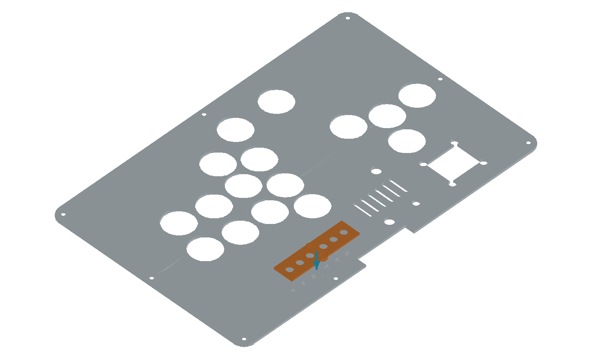

**O02: Option-cap retainer, 1 pieces**

- [option_retainer.stl](STL/option_retainer.stl)

## 23. Check the optional fastener envelopes

If printed, position the two screw and two nut envelopes to inspect the retainer clearances.

**Check:** These four items are visual gauges, not functional fasteners. Remove them if necessary.

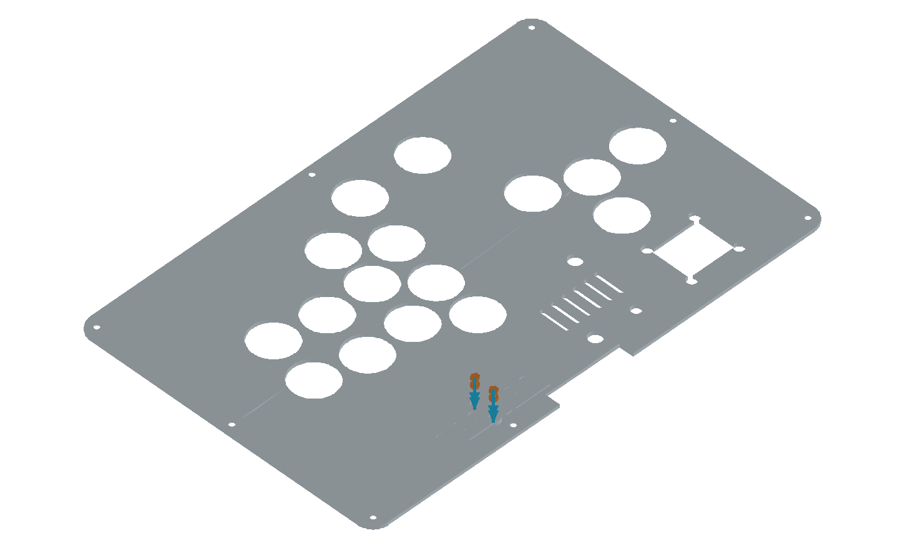

**O03: Optional screw/nut gauges, 4 pieces**

- [option_retainer_M2_nut_envelope_1_SURROGATE.stl](STL/option_retainer_M2_nut_envelope_1_SURROGATE.stl)
- [option_retainer_M2_nut_envelope_2_SURROGATE.stl](STL/option_retainer_M2_nut_envelope_2_SURROGATE.stl)
- [option_retainer_M2x5_pan_screw_envelope_1_SURROGATE.stl](STL/option_retainer_M2x5_pan_screw_envelope_1_SURROGATE.stl)
- [option_retainer_M2x5_pan_screw_envelope_2_SURROGATE.stl](STL/option_retainer_M2x5_pan_screw_envelope_2_SURROGATE.stl)

## 24. Position the upper spacer quarters

Place all four upper-spacer quarters on the empty lower case, aligning the seams and port surrounds.

**Check:** Keep the PCB unit on its separate jig. The next two checks need the empty surrounds.

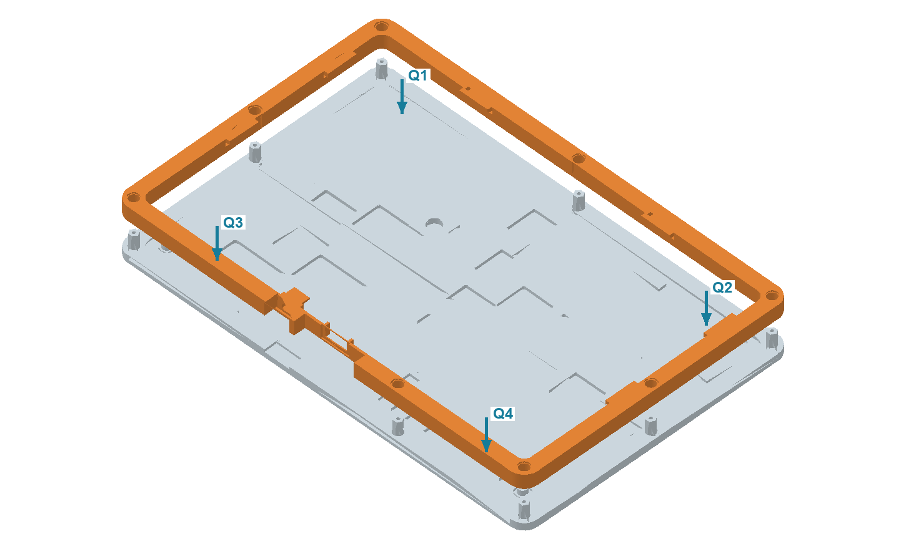

**L02: Upper spacer quarters, 4 pieces**

- [top_spacer_QUARTER_1.stl](STL/top_spacer_QUARTER_1.stl)
- [top_spacer_QUARTER_2.stl](STL/top_spacer_QUARTER_2.stl)
- [top_spacer_QUARTER_3.stl](STL/top_spacer_QUARTER_3.stl)
- [top_spacer_QUARTER_4.stl](STL/top_spacer_QUARTER_4.stl)

## 25. Bench-check the USB-A collar

With the PCB absent, offer the USB-A collar gauge to the USB-A surround. Do not force it.

**Check:** PLA checks shape only. Its rigid opening must not be forced over the coarse USB block.

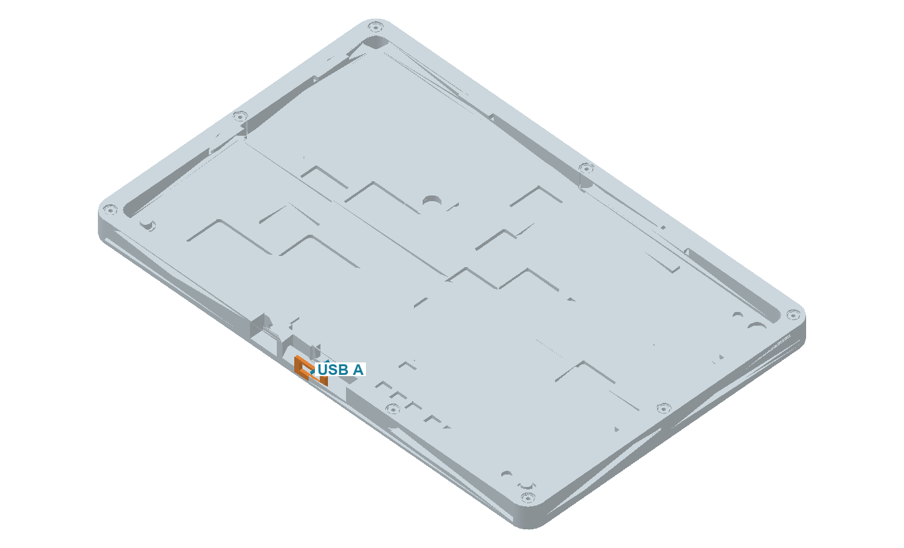

**U01: USB-A collar gauge, 1 pieces**

- [USB_A_collar.stl](STL/USB_A_collar.stl)

## 26. Bench-check the USB-C collar

With the PCB absent, offer the USB-C collar gauge to its smaller contoured surround.

**Check:** Inspect the thin membrane and rear relief. Rigid PLA cannot test a soft seal.

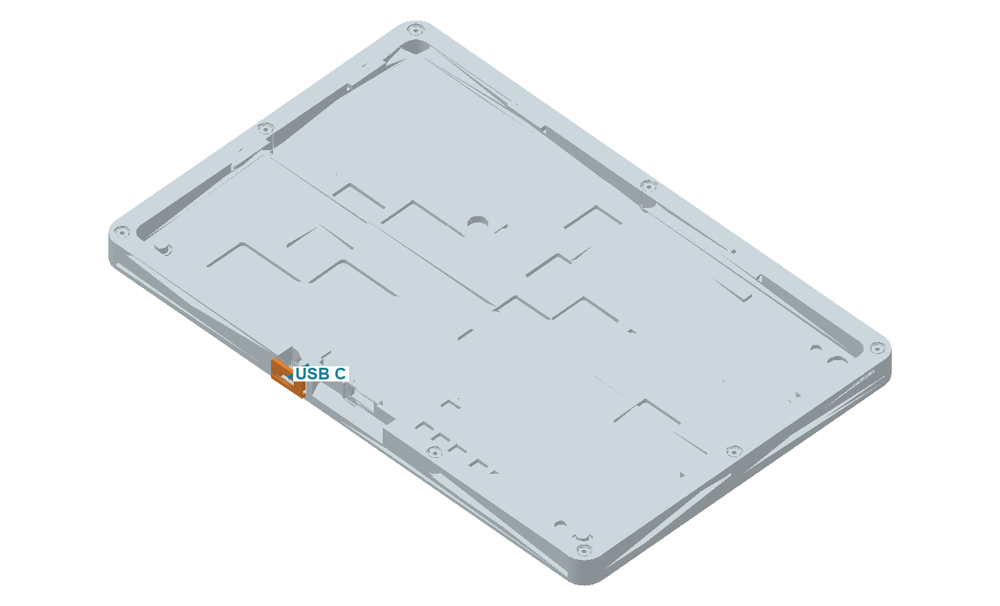

**U02: USB-C collar gauge, 1 pieces**

- [USB_C_collar.stl](STL/USB_C_collar.stl)

## 27. Set the rigid collars aside

Remove both rigid collar gauges before fitting this spacer over the PCB surrogate.

**Check:** The square USB proxy blocks cannot qualify collar or plug fit. Use real TPU and connectors later.

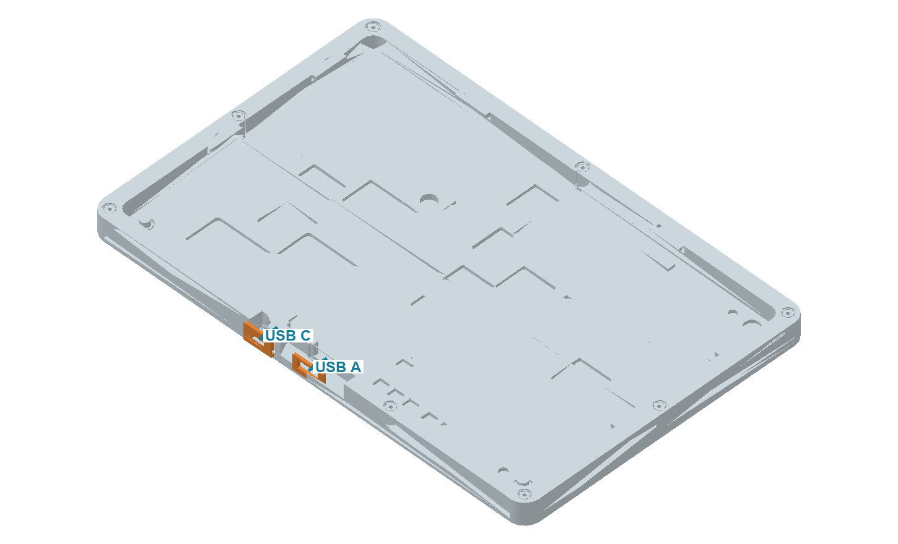

## 28. Lift off the upper spacer

Lift the empty upper-spacer unit off the lower case and set it aside. Keep its quarter positions together.

**Check:** Leave both rigid collars out. The lower case must be open for the PCB unit.

## 29. Lower the completed PCB unit

Lower the completed PCB/switch-plate/heatsink/screen unit into the lower case.

**Check:** Align the loose H4/H6 guides. Keep case posts outside the PCB; do not clamp through it.

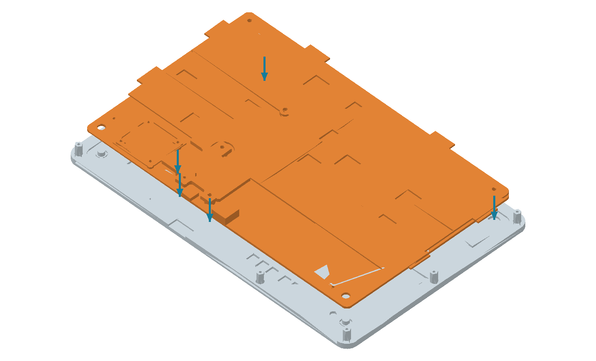

## 30. Place the six upper height gauges

Place one upper gauge on each of the six switch-plate capture tabs.

**Check:** For compliance tests, replace these with real upper foam. Do not stack the two.

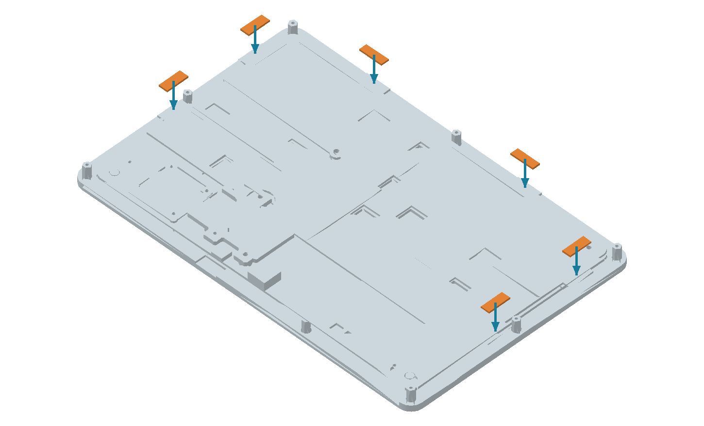

**F02: Upper height gauges, 6 pieces**

- [pad_2_1_INSTALLED_HEIGHT_GAUGE.stl](STL/pad_2_1_INSTALLED_HEIGHT_GAUGE.stl)
- [pad_3_1_INSTALLED_HEIGHT_GAUGE.stl](STL/pad_3_1_INSTALLED_HEIGHT_GAUGE.stl)
- [pad_4_1_INSTALLED_HEIGHT_GAUGE.stl](STL/pad_4_1_INSTALLED_HEIGHT_GAUGE.stl)
- [pad_5_1_INSTALLED_HEIGHT_GAUGE.stl](STL/pad_5_1_INSTALLED_HEIGHT_GAUGE.stl)
- [pad_6_1_INSTALLED_HEIGHT_GAUGE.stl](STL/pad_6_1_INSTALLED_HEIGHT_GAUGE.stl)
- [pad_7_1_INSTALLED_HEIGHT_GAUGE.stl](STL/pad_7_1_INSTALLED_HEIGHT_GAUGE.stl)

## 31. Lower the completed upper spacer

Lower the prepared upper spacer over the case posts and internal unit. Leave the rigid collars aside.

**Check:** Watch the port hoods and option area. No part should need to bend or be forced into place.

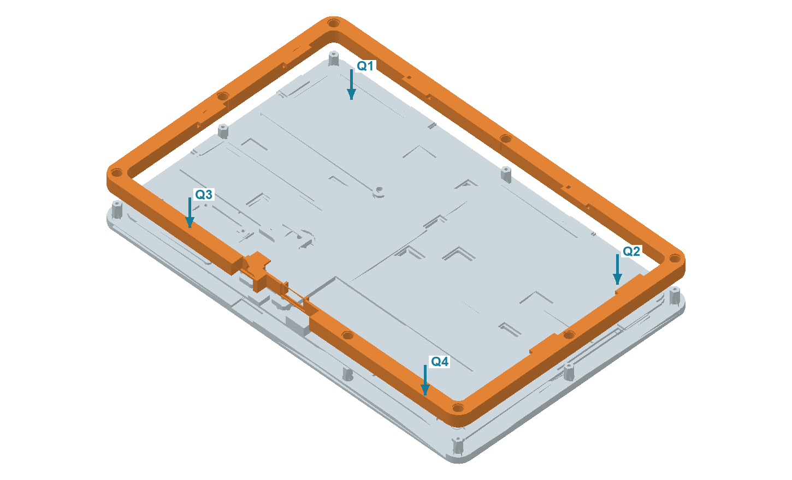

## 32. Add the eight upper washers

Place one upper 0.5 mm washer on each of the eight case posts.

**Check:** Each case column has a lower washer, a 12 mm post and an upper washer.

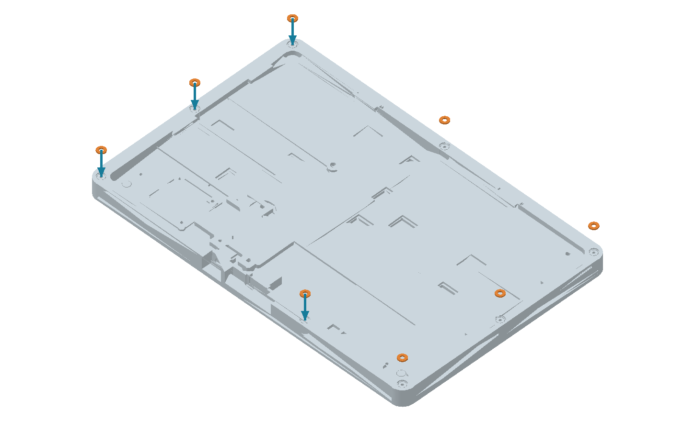

**W02: Upper case washers, 8 pieces**

- [acrylic_case_washer_1_top_0p5_SURROGATE.stl](STL/acrylic_case_washer_1_top_0p5_SURROGATE.stl)
- [acrylic_case_washer_2_top_0p5_SURROGATE.stl](STL/acrylic_case_washer_2_top_0p5_SURROGATE.stl)
- [acrylic_case_washer_3_top_0p5_SURROGATE.stl](STL/acrylic_case_washer_3_top_0p5_SURROGATE.stl)
- [acrylic_case_washer_4_top_0p5_SURROGATE.stl](STL/acrylic_case_washer_4_top_0p5_SURROGATE.stl)
- [acrylic_case_washer_5_top_0p5_SURROGATE.stl](STL/acrylic_case_washer_5_top_0p5_SURROGATE.stl)
- [acrylic_case_washer_6_top_0p5_SURROGATE.stl](STL/acrylic_case_washer_6_top_0p5_SURROGATE.stl)
- [acrylic_case_washer_7_top_0p5_SURROGATE.stl](STL/acrylic_case_washer_7_top_0p5_SURROGATE.stl)
- [acrylic_case_washer_8_top_0p5_SURROGATE.stl](STL/acrylic_case_washer_8_top_0p5_SURROGATE.stl)

## 33. Lower the prepared top panel

Lower the top-panel/cap/retainer subassembly onto the upper washers and spacer.

**Check:** Watch the cap tips and screen frame. Caps will not spring-return on the PCB surrogate.

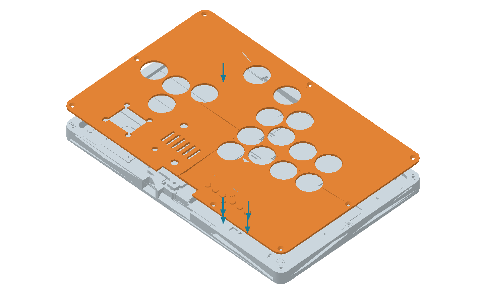

## 34. Hold the mock together lightly

Use light external clamps or temporary tape to keep the panels seated for inspection.

**Check:** Hold at the outer case columns, not across the PCB. Printed fasteners are not functional.

## 35. Check the assembled mock

Measure the closed height and inspect every seam, mounting seat, cap guide and port opening.

**Check:** Nominal case: 292.6 x 191 x 17 mm, excluding keycaps. This is a geometry trial only.

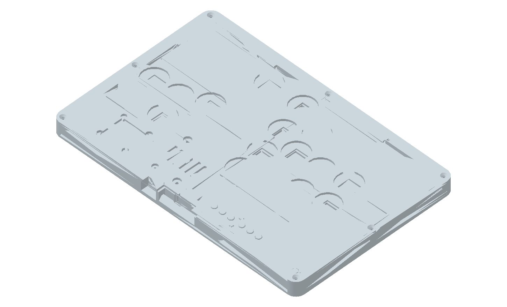

## Source and limits

Illustrations use the saved mock-kit STL meshes and manifest source-coordinate bounds. Collars are restored from their documented print rotation. Orange means the current operation; grey means earlier parts, not a material specification.

The PCB surrogate omits copper, solder, sockets and most components; the OLED surrogate omits glass/header details. Foam movement, real pad preload, threaded retention, actual cable/dongle fit and heat transfer require their separate real-part trials. No CAD geometry or print file was changed.
