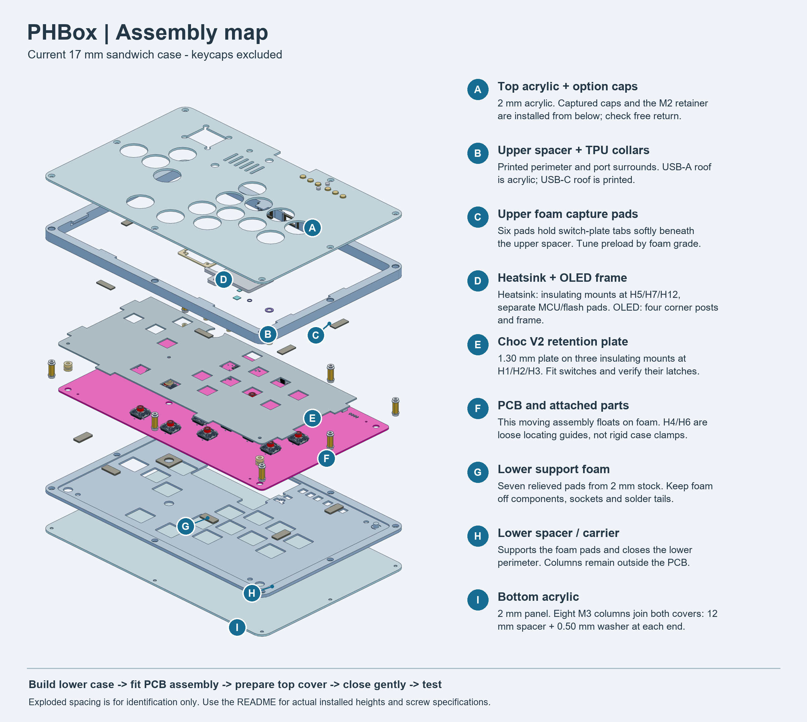
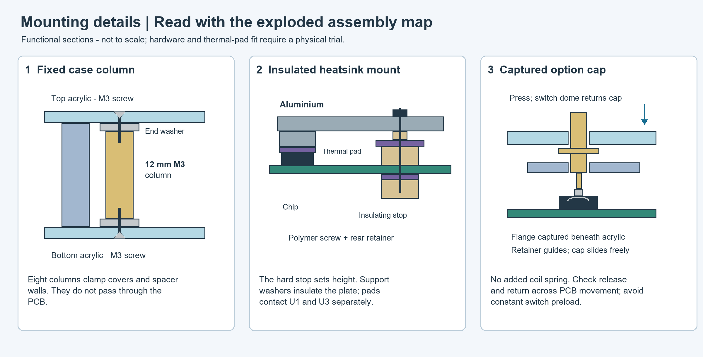

# PHBox 17 mm foam sandwich candidate

This supersedes the earlier 26 mm mounting envelopes. Layer order is top acrylic →
top spacer, Choc V2 switch plate, MCU/flash heatsink and screen frame → current PCB
→ relieved foam → bottom spacer/carrier → bottom acrylic. Keycaps
are excluded from the 17 mm dimension; case screw heads are recessed within it.
The active PCB now uses the top-side C2344 through-hole USB-A revision. Existing
manufacturing exports remain older and must be regenerated before ordering.

## Stack and load paths

Main case envelope is **292.6 × 191.0 × 17.0 mm**. The open-top USB-A grip pocket
ends at the main case edge; maximum envelope is **292.6 × 191.0 × 17.0 mm**. The
USB-A roof is part of the flat 2 mm top acrylic, Z=8..10; there is no raised printed hood. PCB coordinates are retained:
X=KiCad X, Y=−KiCad Y, front component seating plane Z=0. Keycaps protrude through
the top cover; their height is excluded. Recessed case screw heads are within the
cover envelope. Main switch keycaps are not modeled or qualified. Six custom
option-button caps are modeled as a trial fit for the generic H5 tactile switches.

| Region, top to bottom | Installed Z | Thickness / role |
|---|---|---|
| Top cast-acrylic cover | 8..10 | 2.0 |
| Upper working cavity | 0..8 | parallel switch, screen, heatsink and support structures |
| PCB / exported seating allowance | −1.601204..0 | nominal finished board 1.60; measure first article |
| Lower foam support pads | −3.25..−1.601204 | 1.648796 installed from 2.0 free stock |
| Bottom carrier ledge | −5..−3.25 | 1.75 |
| Bottom cast-acrylic cover | −7..−5 | 2.0 |

The printed lower wall is 3.15 high, Z=−5..−1.85; the upper wall is 9.85 high,
Z=−1.85..8. These walls surround the PCB/foam and **must not be added again** to
the stack above. Their 13 mm combined height is fixed by eight continuous case
columns: 12 mm female/female M3 spacer + two 0.50 mm washers. The metal columns
stay outside the board. M3×6 countersunk screws from each cover engage opposite
ends of each spacer and clamp both printed frame layers and covers together.

The moving island consists of PCB + Choc V2 retention plate + insulated heatsink
mounts + screen posts/frame. There are no case screws through this island. Seven
lower foam pads support clear PCB areas; six upper foam pads press the retention
plate tabs beneath the upper spacer ledges. Two Ø5.4 loose guides use H4/H6's
existing Ø6.4 holes for lateral location. The case has 0.60 nominal side clearance
from the PCB and pockets budget **±0.25 Z movement**; guide-hole geometry does not
qualify dynamic stiffness. PCB movement consumes port, keycap and button clearance.

Lower foam geometric compression is about 17.6%; upper pads use 1.50 free / 1.20
installed, or 20%. These are **trial dimensions**, not force-equilibrium results.
Choose nonconductive foam with a compression-load curve; tune grade/contact area
and measure rest height under the complete island. Do not use screw torque to force
these percentages or let switch sockets, OLED tails or rear components bear load.
The lower carrier has through reliefs for sockets, switch pins, all back-side
footprints, OLED tails and heatsink retaining hardware. Foam is excluded from the
electronics zone. An optional thin acoustic liner may sit on other bottom-cover
areas only after its clearance and heat effects are checked; it is not modeled.

## Parts and interfaces

- `STEP/assembly.step`: installed reference assembly with current top-side USB-A
  PCB, existing MCU/flash heatsink/pads/stops, new enclosure and mounting parts.
- `STEP/exploded.step`: presentation offsets show layer order, not working heights.
- `STEP/top_acrylic.step`, `STEP/bottom_acrylic.step`: 2 mm covers, 10 mm outer rim.
  DXFs are nominal through-cut geometry. Make the eight Ø3.4 holes first, then a
  **secondary 90° Ø6.7 countersink, depth 1.65**, leaving nominal 0.35 land. Trial
  cast-acrylic coupons, deburr, support the cover on the washer/column and use low
  torque; countersink cracking and pull-through strength are not qualified. Do not
  add a countersink operation by laser engraving or automatically offset its depth.
- `STEP/top_spacer.step`, `STEP/bottom_spacer.step`: print STL versions for fit.
  Ø6.5 column passages and Ø7.3 × 0.55 end recesses clear the columns/washers. The
  closed connector surrounds replace the former merged rear opening. The upper
  frame includes USB-A sidewalls/supports and an open grip pocket; the top acrylic
  provides its connector roof. All parts end at the main case edge. Whole frames
  require roughly a 300 × 200 mm build area. On smaller printers, split at X=220
  in the slicer and retain each section with the case columns; acrylic bridges
  that butt joint. No bonded-joint strength is assumed.
  **USB-A roof is integral to the acrylic panel**, not a separate printed piece.
  USB-A sidewalls and lower floor remain integral to the spacer halves. USB-C's lower printed roof extends over the connector and joins the spacer rim. Both spacers are valid single solids;
  `port-integration-check.json` checks roof ownership and spacer material.
  Trial the 0.75 mm lower USB-A throat lip before applying insertion loads.
- `STEP/switch_plate.step`, `DXF/switch_plate.dxf`: **1.30 mm aluminium candidate**,
  16 square **14.10 mm** apertures, installed Z=3.0..4.3. Six capture tabs float
  beneath foam pads. Three insulating stops/retainers at H1/H2/H3 attach the plate
  to PCB only. The H7 semicircular relief clears the existing heatsink tongue.
  Top cover openings are Ø26.5, provisionally for approximately **24 mm keycaps**.
  A 30 mm keycap requires revised cutouts/spacing; actual keycap shape, stem depth,
  full-stroke clearance, latch fit and plate stiffness are not yet qualified.
  The closest Ø26.5 cover openings leave approximately 1.50 of acrylic between
  them. Check these narrow webs and overall cover deflection on the first cut.
- `STEP/switch_coupon.step`, `DXF/switch_coupon.dxf`: trial apertures left to right
  14.05, 14.10, 14.15 at 1.30 thickness. Kailh's body/latch drawing informs the
  candidate; it is not a manufacturer-approved plate drawing. Test insertion,
  positive latching and removal on real switches before cutting the complete plate.
- `STEP/screen_frame.step`, `STL/screen_frame.stl`: **40.4 × 38.5 × 1.0** corner
  retaining frame, installed Z=4.2..5.2. Four Ø2.4 screw bores align with the module
  holes on a **30.4 × 28.5** pattern. Corner ears contact the OLED module PCB edge
  at its 4.2 nominal top, not its glass. A header relief keeps wiring accessible.
- `STEP/mounts.step`, `STL/mounts.stl`: custom insulating supports, split into
  individual objects in the slicer. Four Ø4.8 screen posts have a **3.0 mm** seating
  height, Ø2.7 locating pilots and Ø2.2 M2 clear bores. Their rear tapped polymer
  caps stay within the lower cavity. Three Ø8 retention-plate stops have **3.0 mm**
  seating height, Ø6.1 locating pilots and Ø3.4 M3 clear bores. These use existing
  board holes without changes to the PCB. Small printed/tapped caps and polymer
  screws require pullout/torque trials; machined POM is an alternative for stops.
  Both locating pilots extend 1.55 below the front datum, ending inside the nominal
  PCB thickness. Rear cap faces seat at −1.601204, clearing the pilot ends by 0.0512.
  Measure the finished board before sizing these clamp interfaces.
- `STEP/foam.step`, `DXF/foam.dxf`: seven relieved lower pads cut from 2 mm stock.
  `DXF/upper_foam.dxf` supplies four 7×18 / two 19×6 capture pads for 1.5 mm stock. All DXFs
  use millimetres and **zero kerf compensation**; ask the shop to compensate once.
- `STEP/case_hardware.step`: eight metal case columns and sixteen catalog M3×6
  screw models. Harwin spacer geometry is a dimensioned stand-in; threads and
  tolerance are omitted. It is not a machining file.

BOOTSEL/RESET sit beneath the closed acrylic and are reached after cover removal.
The heatsink's existing notch leaves both buttons uncovered by aluminium. The heatsink
retains its insulating thermal interfaces and chip-contact heights. Its H5/H7/H12
head-access holes in the acrylic are Ø8/Ø8/Ø6 so low-profile internal fasteners can
enter the top-cover thickness without touching it. The internal head envelopes
used for checking are Ø6×2.4 for M3 and Ø4×1.6 for M2. Specify actual parts that
fit those envelopes; hardware with taller heads invalidates the nominal height.
The existing heatsink thermal mass remains 17.12 g / 15.34 J/K. The top has vent
slots, but temperature reduction inside an acrylic case still needs measurement.
The shared option-button access slot is replaced by six **Ø6.2** guide openings.
`STEP/option_caps.step` / `STL/option_caps.stl` contain six captured caps: **Ø5.6**
guided bodies, **Ø8 × 0.6** retaining flanges and **Ø1.4** actuator contact tips.
Nominal cap tops sit **1.2 mm above the acrylic**, rising another 0.25 with the PCB.
The flanges hide the PCB through the guide gaps; this is not a dust/IP seal.
`STEP/option_retainer.step` / `STL/option_retainer.stl` provide a **67 × 18** lower
retainer with a 1 mm floor, six guide holes and two M2 captive-nut bosses.
`STEP/option_hardware.step` contains explicit screw/nut fit envelopes, without
threads or drive recesses. Caps are case-guided in XY and follow PCB motion in Z,
resting on actuators and returning through their springs; they do not clamp the PCB.
The exact option-switch MPN is unspecified: the reference is KiCad's generic
`SW_PUSH_6mm_H5mm`. **5 mm actuator height and 0.35 mm operating travel are assumptions**;
test actual height, stroke, spring return, friction and print tolerances before use.
Adjust `ACTUATOR_HEIGHT` in `src/option_common.py` when actual parts are selected.

## Assembly and first trial

For the complete user-facing sequence and mounting load paths, follow
[Final assembly by the user](../../README.md#final-assembly-by-the-user).
The dimensions below provide the detailed fit specifications for that guide.

The exploded view uses wider presentation spacing to separate the layers. Its
part letters match the root README's assembly instructions; its offsets are not
installed dimensions. `make_assembly_graphics.py` creates the annotated map and
functional mount sections. After building `src/exploded.py`, regenerate the CAD
render with `python -m cadgen.cli step snapshot STEP/exploded.step review/exploded.png
--camera iso --width 1400 --height 2000`, then run `python make_assembly_graphics.py`
using the existing CAD interpreter. These are documentation graphics, not fabrication
files. The installed assembly and physical part geometry are unchanged.

| Hardware | Quantity | Nominal candidate |
|---|---:|---|
| Case columns | 8 | M3 female/female, 12 mm, AF5 |
| Column end washers | 16 | Ø7 × Ø3.4 × 0.50 |
| Case screws | 16 | M3×6, 90° countersunk |
| Retention-plate screws | 3 | M3×8 polymer, head within Ø6 × 2.4 |
| Screen screws | 4 | M2×8 polymer, head within Ø4 × 1.6 |
| Custom insulating post/cap pairs | 7 | 3 plate + 4 screen, supplied STEP/STL |
| Lower support pads | 7 | 2 mm free nonconductive foam |
| Upper capture pads | 6 | 1.5 mm free nonconductive foam |
| Trial port collars | 2 | Both 2 mm free-state unfilled TPU 95A; front-face-down STLs include the rear PCB rebate |
| Option retainer screws | 2 | M2×5 pan head, maximum head Ø4 × 1.6 |
| Option retainer nuts | 2 | M2 hex, AF4 × 1.6; printed pockets AF4.4 |
| Captured option caps / retainer | 6 / 1 | Supplied STEP/STL; fit and return trial required |

Internal screw lengths are measured below the head. Nominal M2×8 ends at −2.8
and engages about 1.20 of the screen cap; M3×8 ends at −3.7 and passes through
the 2.0 retention cap by about 0.10. Tapped polymer caps, thread lead/chamfer and
actual screw lengths need a trial; do not substitute longer screws unchecked.

1. Cut the switch coupon and trial the display frame/posts and case countersinks.
   Confirm real PCB thickness, module PCB thickness, package heights and socket
   envelopes. Adjust the source parameters before committing full-size pieces.
2. Fasten the screen at its four corner PCB holes using the insulating posts,
   rear caps, frame and M2 polymer screws. Keep screw load off the glass and use
   a chosen screw length that reaches the retainer without protruding below it.
3. Attach the retention plate with the three insulating posts and M3 polymer
   screws; insert/latch the switches. Fit the heatsink with its original insulating
   hard stops, washers and separately sized MCU/flash pads. These fasteners attach
   only to PCB/plate, not the case. Dry-check BOOTSEL/RESET and screen header access.
4. Assemble bottom cover, eight lower washers, 12 mm case spacers and bottom frame.
   Place the seven lower foam pads on their clear ledge seats. Lower the island
   over the loose H4/H6 guides without forcing it sideways.
5. Insert the option caps from beneath the top cover, with their flanges underneath
   the acrylic. Install the lower retainer and captive nuts using two M2×5 screws.
   Trial every cap's free return and full stroke before placing the cover.
   Place six upper foam pads on the retention tabs. Add upper frame, eight upper
   washers and top cover. Fit the two soft port collars at the connector surrounds,
   trialling their interference retention. Qualify perimeter adhesive only if
   needed, keeping it off contacts and the moving PCB.
   Tighten the case screws lightly onto the fixed columns.
   Measure the island's rest height: tune foam, do not clamp the PCB down hard.
6. Confirm keycap clearance through full switch travel, real dongle/cable insertion,
   screen retention, button access and ±0.25 motion. Test temperatures and a modest
   handling load before repeated use. This is a **fit candidate**, not a released
   enclosure or demonstrated shock/thermal performance.

The compact trial consumes its small clearance budget quickly. The nominal rear
tail gap to the bottom cover is 0.50, reducing to 0.25 at downward travel; the
heatsink web gap to top acrylic is 1.00, reducing to 0.75 upward. Real PCB warp,
OLED pin length, foam creep and machining/printing tolerances can consume these.
Trimming excess OLED pin tails after assembly can recover rear margin, but their
actual solder joint must remain intact. No pin trimming is represented in this CAD.

## Why not 15 mm yet

This candidate chooses the upper end of the requested range to preserve the
current PCB and heatsink. Reducing another 2 mm requires a separate stack change:
shorter rear OLED tails / low-profile retaining hardware, a shallower or open
top around the heatsink, lower-profile internal heads, and less foam movement.
Current rear sockets also reach about −3.47. Simply subtracting 2 mm from these
walls would create contact or remove the clearance budget. No 15 mm file is being
presented as a verified fit.

## Open grip pocket and enclosed connectors

The revised USB-A pocket is **43 mm wide**, open above, with **9.623 mm depth
beyond the mating face** and **2 mm sidewalls** terminating at Z=8 beneath the
acrylic. The connector body is roofed by the **2 mm top acrylic**, Z=8..10.
The shell clears the acrylic underside by **0.75 mm at maximum upward PCB travel**.
Its full footprint, expanded by ±0.5 mm XY movement, remains covered. The acrylic
roof ends at Y=−33.4, **0.24 mm beyond the outward-most shell pose**; the open pocket
continues **8.883 mm** to the case edge. The opening leaves a 20 × 9.1 mm throat.

**Dongle fit is conditional:** the 15 × 15 × 8 mm body gauge assumes **2 mm
setback from the connector mating face to the body**, in addition to ±0.5 mm
vertical axis offset and PCB movement. At the inward-most PCB pose, geometric
minimum setback is **1.24 mm**, leaving 0.76 mm with the test assumption. This is
not a manufacturer-specified dimension. Measure a fully inserted dongle before
cutting the final acrylic. A body beginning at the mating face conflicts with
this flat roof; `usb-recess-check.json` retains that failed envelope as an explicit
negative control. The checked body projects **7.377 mm outside the case**.
Ø12 side-pinch finger gauges and extraction poses are checked. Leave at least
50 mm of unobstructed pull-out space outside the case. Transparent acrylic
covers the connector physically but does not hide it visually or establish a seal.

USB-C has an **18 wide × 10.5 high** tunnel with an integral printed roof,
Z=6.855..8, beneath the acrylic. The roof extends over the full connector
footprint plus ±0.5 mm XY movement. The rear roof clears its shell by **3.395 mm**;
the contoured front collar clears the highest shell pose by **0.20 mm**.
Its 11 × 10 mm rear extension has a back edge at Y=−42.4 and clears the heatsink and H12 screw envelope. Its
mouth is recessed **9.292 mm** from the native connector mating face. The gauge
uses a 13 × 8 overmold with a conservatively allocated 28 mm external length;
most of it remains outside the case for grip. The assumed 1.65 mm spacing between
the receptacle face and inserted overmold is a physical-trial datum. The CAD does
not establish compatibility with every cable, right-angle plug or dongle.

`STEP/port_seals.step` shows two free-state **2 mm** unfilled, nonconductive
**TPU 95A trial collars**. Print one each of `STL/usb_a_collar.stl` and
`STL/usb_c_collar.stl`: front face is already down on Z=0, with the rear relief
upward. Their installed forward faces sit at Y=-33.6 against the integral
0.4 mm spacer lips. Trial outer interference retention first; if collars walk
out during unplugging, qualify a thin TPU-compatible adhesive at the outer seat
only. Keep adhesive off the PCB and connector contacts.

The rear PCB rebate is included in both meshes: it removes material behind
Y=-33.916558 between Z=-1.951204 and Z=0.35, leaving a **0.317 mm front membrane**.
Use a 0.10 mm layer-height trial, inspect the sliced membrane and print quality,
and reject torn or excessively stiff collars. Stiffness, creep and retention
require physical trials; there is no environmental ingress rating. The old
`DXF/port_seals.dxf` is a profile reference only, not a TPU manufacturing file.
Other mounts, spacer walls and PCB support foam remain unchanged. See the
[cost and delivery sourcing list](materials.md).

Saved collar verification: `port-seals-check.json` checks aperture coverage and
nine PCB edge poses; `collar-print-check.json` checks both single solids, front-face-down
orientation, dimensions and closed STL edges. The printable parts are
20.4×9.5×2 mm (A) and 18.4×10.9×2 mm (C). These checks do not qualify TPU force
or the thin membrane's print quality. Run `checks/check_port_seals.py` and
`checks/check_collar_prints.py` after regenerating the collar sources.

The rigid access apertures are **15.8 × 6.6 mm (R0.20) for USB-A** and
**10.34 × 4.11 mm (R1.455) for USB-C**. They clear shell movement and metal plug noses; the larger overmolds
remain forward of the lips. Soft collars close the remaining clearance around
the shells. The USB-A free-state TPU collar is **20.4 × 9.5**, with a **14.2 × 5.5**
opening offset **0.70 mm upward**. The USB-C collar is **18.4 × 10.9**, with an
**8.74 × 3.01 (R1.155)** opening centered vertically, matching the native shell
R1.255 with a 0.10 mm inward offset. Both compress nominally **0.20 mm**
into the surrounds and interfere **0.10 mm** per side with the mating-shell
nominal envelope. The 2 mm axial stock maintains engagement over the allowed
±0.5 mm connector movement. These intentional soft contacts are excluded from
rigid collision tests; compliant deformation is not simulated.

The USB-A roof remains the flat acrylic panel. Its sidewalls, lower floor and
seal seat are integral spacer geometry. USB-C's roof and upper surround are
integral with the upper spacer; its lower seal web joins the lower spacer on
the existing Z=−1.85 parting plane. Both sides of the C tunnel close against the
spacer halves. Print the **0.4 mm seal-retaining lips** as continuous walls with a
suitable extrusion width and trial them before use; they retain TPU collars and are not
qualified insertion-force braces. The acrylic fasteners provide roof clamping.
Trial a removable, thin seam bead at cover/wall joints and the spacer parting
seam if dust exclusion is required. Seam seal thickness is not in the rigid stack.

Trial the TPU collars and test insertion, PCB rest height, ±0.5 XY/±0.25 Z board
movement, adhesive retention and creep. Do not rigidly clamp the connector shells:
that would bypass the floating PCB mount. The mating openings stay accessible;
this is a trial dust-gap closure, not a validated waterproof enclosure.

Mechanical references, not firmware compatibility guarantees:

- [Mayflash MAGPS4](https://mayflash.com/product/MAGPS4.html): manufacturer dimensions
  15 × 15 × 8 mm. The page does not identify the plug-axis offset or split body/nose
  length. All 15 mm is allocated to external body, with ±0.5 vertical offset in the
  gauge plus the unverified 2 mm body setback; an actual sample must confirm both before final fabrication.
- [Club 3D CAC-1535 manufacturer sheet](https://www.club-3d.com/web/image/33200): USB-C
  connector 28 × 12.5 × 8 mm. This informs the envelope, not a cable recommendation.
- [StarTech CC1M80GUSB4CABLEW](https://www.startech.com/en-eu/cables/cc1m80gusb4cablew):
  published overall width12.8 and height6.9 further inform the rounded13 × 8 gauge.
  These published envelopes do not supply precise mating/overmold setbacks.
- [Cosmox Booter5](https://cosmoxgaming.com/accessories/booter5/) has no dimensioned
  drawing on the product page and is not claimed as a verified mechanical fit.

## Evidence, rebuild and provenance

`fit-check.json` records the final saved-part validity, nominal intersections,
hard-body travel and internal screw-head envelope checks. `checks/check_fit.py`
uses native solid-pair operations and conservative containment in actual cut
openings, rather than aggregate imported-compound intersection. These are nominal
checks; foam force equilibrium, switch latch deflection, acrylic/plate stiffness,
insert/retainer strength, real keycaps and dongles require first-article tests.
The saved-part fit check passed; its board-candidate count is recorded in `fit-check.json`:
zero board overlaps, zero new-part or internal mount-piece overlaps, zero rigid
overlaps at ±0.25 movement, and zero internal screw-head envelope overlaps.
`usb-recess-check.json` records 1,116 native solid-pair tests with zero collisions
for connector ±0.5 XY/±0.25 Z movement, the conditional 2 mm-setback body gauges and side
finger gauges. Exact native case cropping accelerates this check while retaining
all material within the possible contact window. Soft seals are not rigid collision
targets. `option-caps-check.json` records **864** cap/guide/retainer/hardware native
solid-pair checks with no intersections, across ±0.25 PCB Z, 0/0.35/0.45 cap stroke
and 0.30 radial guide play. Minimum projected flange overlap is 0.60 mm; downward
stop margin at the assumed operating stroke is 0.10 mm. Internal switch actuation
is assumed, not simulated. `roof-shield-check.json` verifies the acrylic USB-A roof and printed USB-C roof over their
native footprints expanded by ±0.5 XY, and zero roof obstruction over
the open grip pocket. All six primary
cover/frame/plate parts are valid single solids. The current PCB SHA-256 is
recorded in `fit-check.json`; the USB replacement and routing audit are documented
in [the current assessment](../USB2-C2344-assessment-2026-10-09.md).
`review/` contains reviewed saved-artifact snapshots. `snapshot-job.json` makes
the part/assembly views reproducible. Parametric geometry is in `src/common.py`.
All seven cutting DXFs pass the millimetre-unit and DXF audit checks, with zero
audit errors; see `cut-check.json`. `dxf-snapshot-job.json` covers those profiles.

Use the existing `../heatsink_2026-10-08/.venv` interpreter and its CAD cache/browser.
Set `CADGEN_DAEMON=0`, `OPENBLAS_NUM_THREADS=1`, `OMP_NUM_THREADS=1`. Build
`src/assembly.py`, then `src/exploded.py`, cut entrypoints, `checks/check_fit.py`
and `checks/check_usb_recess.py`, followed by `checks/check_roof_shield.py` and
`checks/check_option_caps.py` and `checks/check_port_integration.py`.
The viewer only opens saved files; `view_ocp.py --port 3939` sends the assembly to
VSCode OCP. Printed STLs are in installed coordinates: split disconnected mount
parts into objects, orient their flat seating faces to the bed and drop to Z=0.
For the six option caps, put the top face on the bed and support underneath the
retaining flange; clean the guide surfaces carefully. Print the retainer on its
flat underside, bridging the short nut-pocket roofs. Check printed hole sizes
and cap return on a coupon before committing the full case.

- [Kailh Choc V2 manufacturer drawing](https://cdn.shopify.com/s/files/1/0657/6075/5954/files/SPEC-CPG135301D01_Kailh_Choc_V2_Low_Profile_Red_Switch_03cd29a8-065e-45f8-8053-b72dcd70616d.pdf?v=1667190153): 13.95±0.05 body, 15 mm flange and latch geometry. Plate dimensions are prototype interpretations requiring a coupon.
- [Harwin R30-1001202](https://www.harwin.com/products/R30-1001202): M3 female/female, body12, AF5. The STEP Parts female/female search returned records with contradictory `male_female` attributes, so they were not used as vendor geometry. The manufacturer TraceParts export requires account/email access; the documented envelope suffices for this fit candidate.
- M3×6 model: `iso10642_socket_countersunk_screw_m3x6` from [STEP Parts](https://www.step.parts/parts/iso10642_socket_countersunk_screw_m3x6), downloaded and SHA-256 verified against `hardware-catalog-search.json`. Nylon M2/M3 searches returned no models; internal heads are checked as explicitly stated envelopes.
- Reused PCB, OLED and heatsink geometry/provenance are in [the heatsink project](../heatsink_2026-10-08/README.md). Reused Choc V2 community geometry remains subject to koktoh's CC BY-NC-SA 4.0 attribution/licence recorded in the model-completion and LED-fit folders.

This foam sandwich order supersedes the older separate-bottom-spreader/gasket-tab
layout for this candidate. No bottom aluminium plate is added beneath the foam.
Fabrication exports remain the earlier PCB revision noted in the root README;
this mechanical work does not refresh Gerbers, BOM or CPL or place an order.

The fit review corrected lower switch-housing interference by raising the
retention plate, rounded its board corners, relieved the display glass at all
four frame ears, and cleared the six through-hole option-button solder tails.
Case countersinks were enlarged against the actual catalog screw envelope.
The plate plane clears the reference switch model; positive snap engagement
still requires a real switch/coupon trial. The shallow remaining acrylic land
requires a supported countersink trial and low torque before final production.

The assembly was sent to the existing VSCode OCP viewer. Its measurement backend
reported disconnected. A separate CAD Viewer launch did not return a URL; its
stalled launcher was stopped. STEP and reviewed snapshots remain available.

### Current port closure revision

USB-A uses the acrylic roof; USB-C uses its lower integral printed roof. Both
spacer surrounds retain the 2 mm soft collars against integral front lips.
No rigid connector clamp is added. Connector insertion loads remain supported
by their PCB solder joints; compliant seal support is not strength-qualified.
`port-seals-check.json` verifies closed front projection outside each mating
hole and zero contact with the native PCB edge across nine Y/Z poses. Saved
native checks record roof continuity, integral material, single-solid
spacers, connector/plug fit and PCB travel. The printed C roof is included in
collision checks inside the otherwise-empty electronics opening.

### Contoured collars and reference option buttons

The front collars extend 2.8 mm rearward from the seal seats. USB-A has integral
side cheeks and retains its acrylic roof; USB-C has a close rounded printed
hood with 0.20 mm clearance at maximum upward PCB travel. The rear USB-C roof
clearance is 3.395 mm. Both leave clearance for the floating PCB and use the
soft collars to close the remaining shell gaps.

[Reference-case study](reference-case-study.md) compares measured Flatbox Rev 8
and Open_Core0 port geometry and their option-button arrangements. Retain our
individual captured H5 plungers for the acrylic top: Flatbox printed flaps would
need a separate insert, and its silicone-cap version uses taller H7 switches.
The tact switches provide their own click and return; no extra coil springs
are fitted. Verify real switch force/stroke and cap return before fabrication.

`STEP/port_detail.step` and `review/port_detail.png` show a sectioned presentation
close-up of both surrounds. Its exposed crop faces are not openings in the full
case and the cropped geometry is not a manufacturing part. The latest native
fit check tested 710 board candidates without overlaps; all 1,116 connector,
conditional plug and finger-gauge pairs passed. Collar projection, PCB edge
motion, roof continuity and all seven cutting-DXF audits also passed.

The first OCP resend found port 3939 closed. Reopening `view_ocp.py` in the existing
VSCode project restarted the extension's automatic viewer. The latest assembly
was then sent successfully; viewport status reported 35 assembly entries including
the current PCB and heatsink. `review/ocp-reopened.png` records the reviewed live
viewport capture. Assembly and exploded STEP exports are current.

